## About this lab { #about data-toc-label="About this lab" }

<p class="tagline"><del>From a phone menu</del> <span>to a receptionist that understands.</span></p>

The **Webex Calling AI Receptionist** is a virtual assistant that answers your organization's incoming calls. It responds to simple questions, and when a caller needs more help, it transfers them to a queue or a person. You manage it in Collaboration Control Hub, where you choose its voice, add your company information and set its routing rules. It works for a single site or for many.

In this lab you build an AI Receptionist from start to finish in Collaboration Control Hub:

- Assign it a Webex Calling phone number that callers dial.
- Choose its language and voice.
- Write its welcome greeting and the guidelines it follows on every call.
- Build a knowledge base from FAQs and business documents, so it can answer questions such as office hours, pricing and warranties.
- Add caller intents that route each call to the right destination.

To give the AI Receptionist somewhere to send calls, you also set up **Webex Calling Customer Assist** with two basic call queues, their agents and a supervisor. Then you call the AI Receptionist, ask it questions in natural language and watch it transfer you to the right queue or person.

!!! info "About the lab region and phone numbers"
    We run this lab for audiences in many parts of the world, but the lab environment is always the same: it runs in **dCloud** on a Webex organization in the **US data center**, with a **US numbering plan** for Webex Calling. The phone numbers, number formats and examples you see in this guide come from that setup.

    That's fine for learning. The goal is to understand how the AI Receptionist and Customer Assist work and how to configure them, and those steps are the same wherever you are.

    When you deploy in your own region, plan your PSTN connectivity first. Webex Calling supports several options for getting local phone numbers, such as Cisco Calling Plans, a Cloud Connected PSTN provider, or Premises-based PSTN through your own Local Gateway. Once your numbers are in Collaboration Control Hub, you assign them to the AI Receptionist and your queues exactly as you do in this lab. Also check that the AI Receptionist is available in your region and supports your language: it is offered in select regions, and its prompts and templates are English only for now.

!!! note "Scope"
    The lab gives configuration examples. It is not a complete calling design and does not cover every available feature. If you have design questions, ask your lab proctor or reach out to your Cisco representative.

### Lab at a glance { #glance data-toc-label="Lab at a glance" }

<div class="glance time" markdown>

| | Task | Time |
|---|---|---|
|  | [AI Receptionist overview](#air-overview) | 5 min |
| 1 | [AI Receptionist configuration](#task-1) | 15 min |
|  | [Customer Assist overview](#ca-overview) | 5 min |
| 2 | [Prepare Webex Calling for Customer Assist](#task-2) | 22 min |
| 3 | [Create the Auto Attendant](#task-3) | 10 min |
| 4 | [Create the Customer Assist queues and verify agents](#task-4) | 12 min |
| 5 | [Add a supervisor for Customer Assist](#task-5) | 2 min |
| 6 | [Advanced Customer Assist queue configuration](#task-6) | 20 min |
| 7 | [AI Receptionist intent-based routing](#task-7) | 10 min |
|  | [Call-in options](#call-in) | 2 min |
| 8 | [Log test users into the Webex App](#task-8) | 10 min |
| 9 | [Verify the AI Receptionist](#task-9) | 10 min |
| 10 | [Agent and supervisor experience in the Webex App](#task-10) | 4 min |
| 11 | [Agent and supervisor queue call experience](#task-11) | 9 min |
| 12 | [Collaboration Control Hub admin experience](#task-12) | 7 min |
| | **Total** | **~145 min** |

</div>

### Learning outcomes { #outcomes data-toc-label="Learning outcomes" }

When you finish this lab, you will:

- [ ] Know the fundamentals of the Webex Calling AI Receptionist: its key capabilities, how to configure it and how it works.
- [ ] Configure an AI Receptionist with its knowledge base, and call it to experience it as a caller.
- [ ] Configure and use advanced Customer Assist features.

### How to use this guide { #how-to data-toc-label="How to use this guide" }

The whole lab lives on this **one page**. Scroll down and work through it in order.

- The **TREE** on the left shows where you are. The progress bar under it fills up as you scroll.
- Press <kbd>J</kbd> / <kbd>K</kbd> to jump to the next or previous section.
- When you finish a task, click **Mark complete** at the end of it. You get a ✓ in the tree, and your progress is saved in this browser.
- Every command and block of configuration text has a **copy** button in its top-right corner.
- Click **Notes** (bottom-right) to keep your session ID, domain, password and phone numbers close at hand. Notes stay in this browser only.
- Click any screenshot to zoom in.

### Your lab proctor { #proctors data-toc-label="Your lab proctor" }

Need help? Raise your hand or reach out to me.

<div class="people" markdown>

<div class="person"><span class="nm">Omer Ilyas</span><span class="rl">Principal Technical Marketing Engineer</span><span class="em">oilyas@cisco.com</span></div>

</div>

<p class="eyebrow">Overview · ≈ 5 min</p>

## AI Receptionist overview { #air-overview data-toc-label="AI Receptionist overview" }

The **Webex Calling AI Receptionist** is a virtual assistant that answers your incoming calls, day or night. It understands what callers say in natural language, answers common questions, and transfers callers to the right person or Webex Calling resource when they need more help. You create and manage it in Collaboration Control Hub.

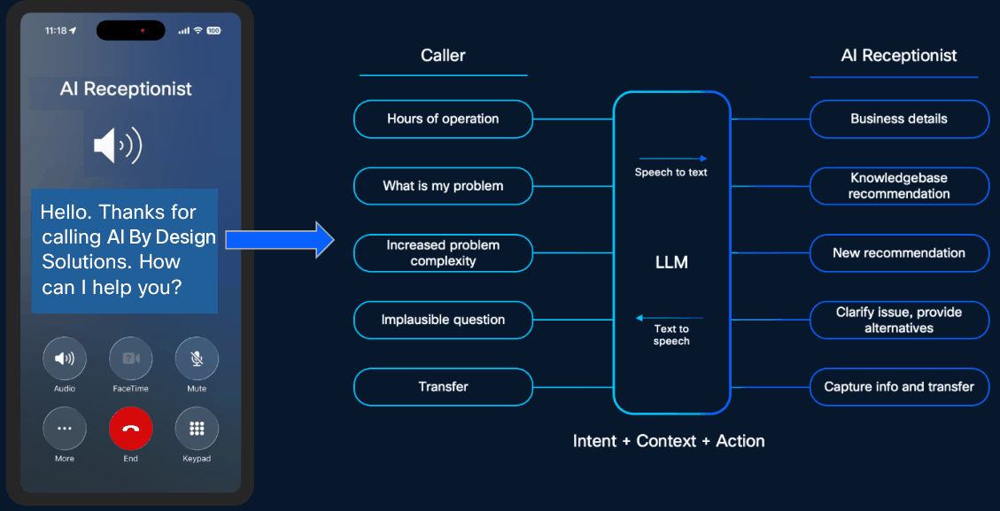{ loading=lazy }

/// caption
The AI Receptionist turns what the caller says into intent, context and action.
///

#### What it can do

- Answer calls 24/7 and handle simple, common questions, even after hours.
- Share company details such as office hours, locations, parking and holiday closures.
- Transfer callers to a user, call queue, hunt group, auto attendant, workspace or external number.
- Serve one location or many, with a main number, an extension and up to 10 alternate numbers.
- Speak in a natural-sounding voice you choose, and tell callers they are talking to an AI.

#### How it works

<div class="models">
<div><b>Guidelines</b><span>A goal, welcome greeting and instructions that set how it talks to callers. Industry templates give you a starting point.</span></div>
<div><b>Knowledge base</b><span>FAQs, policies and product details (PDF, DOCX, TXT, XLSX, XLS, CSV) it uses to answer questions.</span></div>
<div><b>Intents</b><span>Each intent describes, in plain language, when to transfer a call and where to send it.</span></div>
<div><b>Default action</b><span>What happens when nothing else fits: transfer to a user or number, or play a message and end the call.</span></div>
</div>

!!! info "Good to know"
    - The AI Receptionist is an **add-on** to the Webex Calling Professional license, sold in bundles of minutes. Collaboration Control Hub tracks usage and has call-handling reports.
    - You pick an **AI engine** when you create it: **Webex AI Pro** for global languages, **Webex AI Pro-US** for English-only US deployments, or **Webex AI Pro EU 2.0** for European organizations.
    - It's available in select regions, and prompts, templates and intent names are English only for now.

    For full details, see [AI Receptionist in Webex Calling](https://help.webex.com/en-us/article/4chov0/AI-Receptionist-in-Webex-Calling){:target="_blank" rel="noopener"} on the Webex Help Center.

#### Roadmap

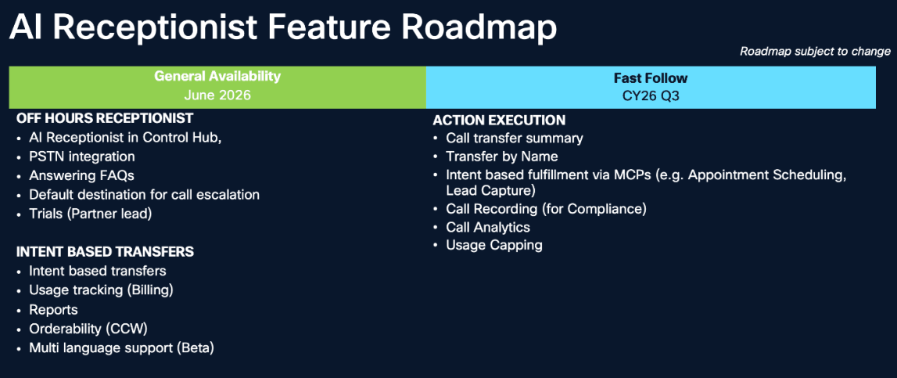{ loading=lazy }

/// caption
AI Receptionist feature roadmap: General Availability (June 2026) and Fast Follow (CY26 Q3). Roadmap subject to change.
///

#### What you will build in this lab

You configure your own AI Receptionist for **AI By Design Solutions**, a Cisco collaboration consulting firm.

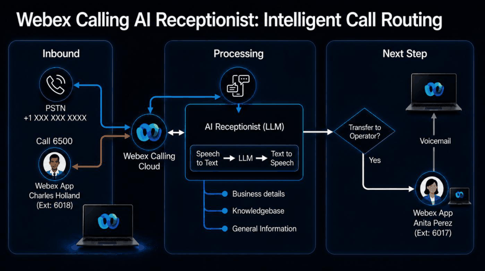{ loading=lazy }

/// caption
The AI Receptionist call flow you build: inbound call, LLM processing, then transfer to the operator or voicemail.
///

It is the caller's first point of contact: it answers their questions from its knowledge base and sends them to the right person or queue when they need more help. The lab has two parts:

1. **AI Receptionist configuration** ([Task 1](#task-1))
    - Configure the AI Receptionist and its operational guidelines
    - Build and populate the AI Receptionist knowledge base

2. **Intent-based routing and validation** ([Tasks 7 to 9](#task-7))
    - Define and map intent-based call routing
    - Log in to the Webex App
    - Make test calls
    - Validate the AI Receptionist workflow and call escalation

<p class="eyebrow">Task 1 · ≈ 15 min</p>

## AI Receptionist configuration { #task-1 data-toc-label="Task 1 · AI Receptionist setup" data-task="1" }

In this task you build a knowledge base, then create an AI Receptionist that uses it to answer callers' common questions. If it can't help, it transfers the call to a person.

### Step 1: Open the AI Receptionist in Collaboration Control Hub { #t1-s1 data-toc-label="Step 1 · Open AI Receptionist" }

See [Accessing your lab](../index.md#access) in Part 1 if you need to log in to Collaboration Control Hub.

1. In Collaboration Control Hub, click **SERVICES > Calling**.
2. Select the **AI Receptionist** tab in the top menu.

    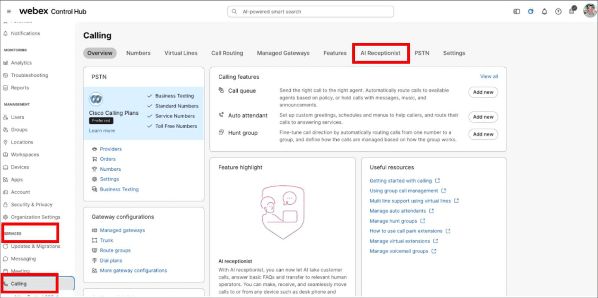{ loading=lazy }

    /// caption
    SERVICES > Calling > AI Receptionist.
    ///

3. You see the screen below.

    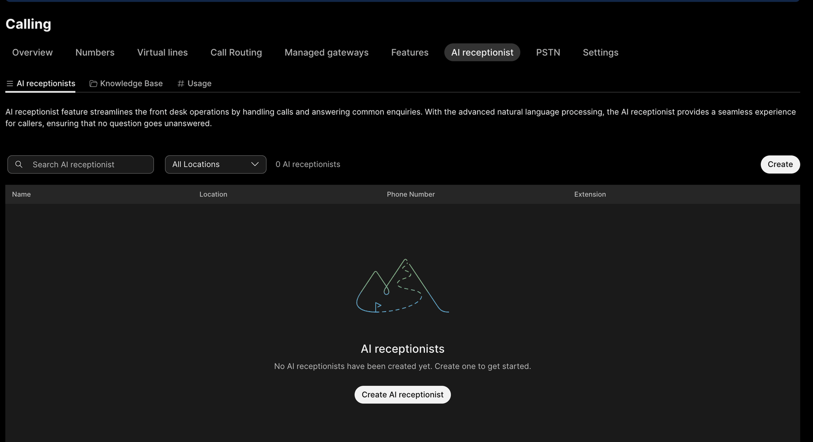{ loading=lazy }

    /// caption
    The AI receptionists, Knowledge Base and Usage tabs.
    ///

    You have three ways to create the AI Receptionist and the knowledge base it uses to answer frequently asked questions:

    1. Create the knowledge base while you create the AI Receptionist.
    2. Create the AI Receptionist first, and the knowledge base later.
    3. Create the knowledge base first, and assign it to the AI Receptionist when you create it.

    In this lab you use **option 3**: create the knowledge base first and assign it to the AI Receptionist when you create it.

### Step 2: Set up the knowledge base { #t1-s2 data-toc-label="Step 2 · Knowledge base" }

In this step you create a knowledge base and add the information the AI Receptionist uses to talk with callers and answer common questions.

1. Click the **Knowledge Base** tab.
2. On the Knowledge Base page, click **Create knowledge base** or **Create**.

    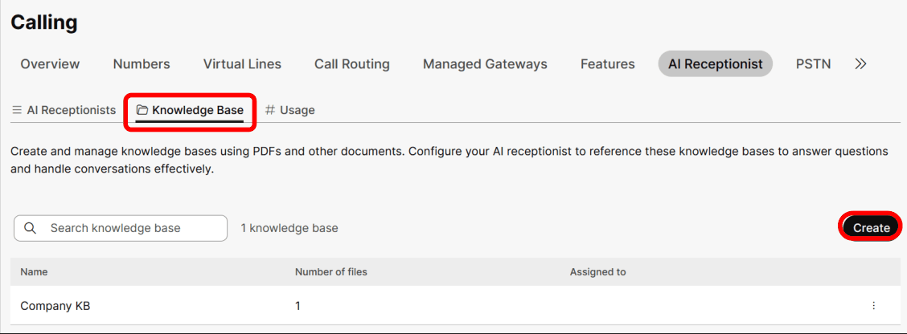{ loading=lazy }

    /// caption
    Knowledge Base tab: click Create.
    ///

    !!! warning "Known caveat"
        Adding files to a knowledge base can sometimes take 30 minutes or more.

3. For **Knowledge base name** enter `AI By Design Solutions`, and for the description enter `FAQ`. You can add more detail for your own future reference.
4. Click **Create**.

    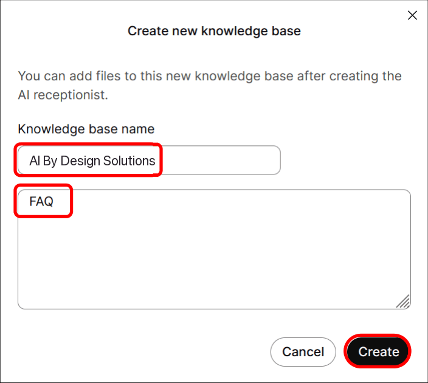{ loading=lazy }

    /// caption
    Create new knowledge base: AI By Design Solutions, FAQ.
    ///

5. The new knowledge base appears with **0** files. Next you add some files to it.

    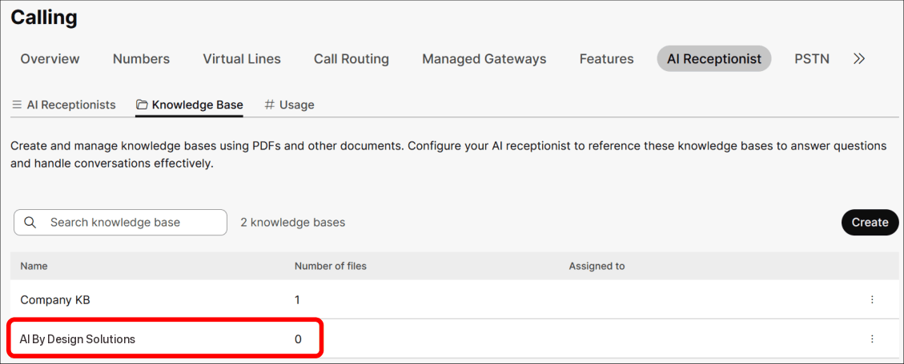{ loading=lazy }

    /// caption
    AI By Design Solutions is listed with 0 files.
    ///

6. Click the **AI By Design Solutions** knowledge base to open it so you can add files.
7. Download the two text files for this lab. Click each link to save it to your computer:
    - [`AI By Design Solutions-KB.txt`](files/AI%20By%20Design%20Solutions-KB.txt){ download="AI By Design Solutions-KB.txt" }: the FAQ you upload to the knowledge base.
    - [`AI Receptionist Config.txt`](files/AI%20Receptionist%20Config.txt){ download="AI Receptionist Config.txt" }: the receptionist guidelines and the `AfterHours_Rates` article text you copy and paste later in this task.

8. Open `AI By Design Solutions-KB.txt` in any text editor (for example Notepad or TextEdit). Take a moment to review the questions and answers in the file.

    !!! note "Build your own knowledge base"
        In a real deployment, build your own knowledge base documents from your accurate business workflow and call flow requirements. This is the most important part of using the AI Receptionist well.

        - Supported file types: PDF, DOCX, TXT, XLSX, XLS, CSV
        - File size limits: TXT up to 2 MB, all other formats up to 10 MB

9. On the AI By Design Solutions knowledge base page, click **Add** to add files to it.

    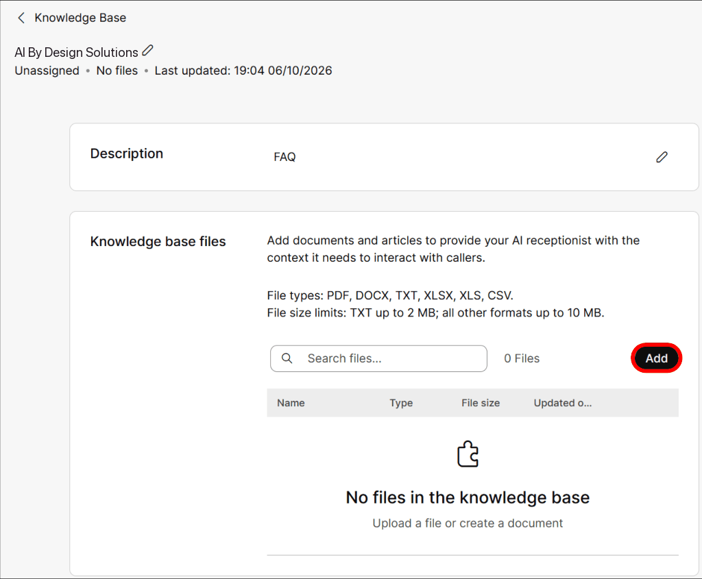{ loading=lazy }

    /// caption
    The empty AI By Design Solutions knowledge base: click Add.
    ///

10. On the **Upload** tab, click **Choose a file**. You can also drag and drop files.

    The AI Receptionist uses the information in these files to answer callers' FAQs. Notice there is also a **Create** tab, which you use later in the lab.

    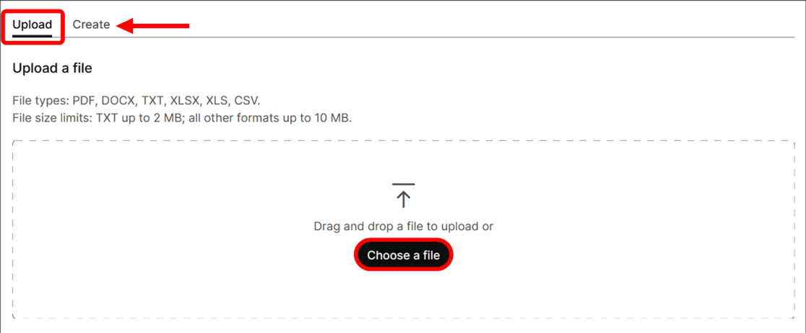{ loading=lazy }

    /// caption
    Upload tab: Choose a file. The arrow marks the Create tab, which you use later.
    ///

11. Select the `AI By Design Solutions-KB.txt` file you downloaded and click **Open**.

    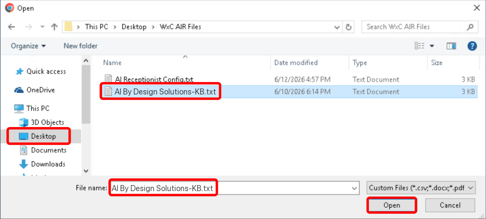{ loading=lazy }

    /// caption
    Select AI By Design Solutions-KB.txt and click Open.
    ///

12. Check the file you selected and click **Add** to upload it to the knowledge base.

    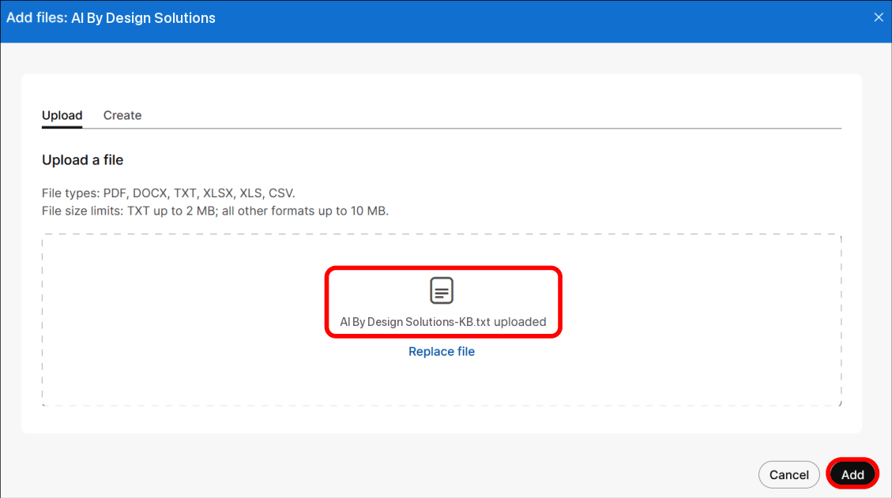{ loading=lazy }

    /// caption
    The file is uploaded: click Add.
    ///

13. A confirmation toast appears at the bottom right of the screen when the upload is complete. Check that the file is listed under the AI By Design Solutions knowledge base.

    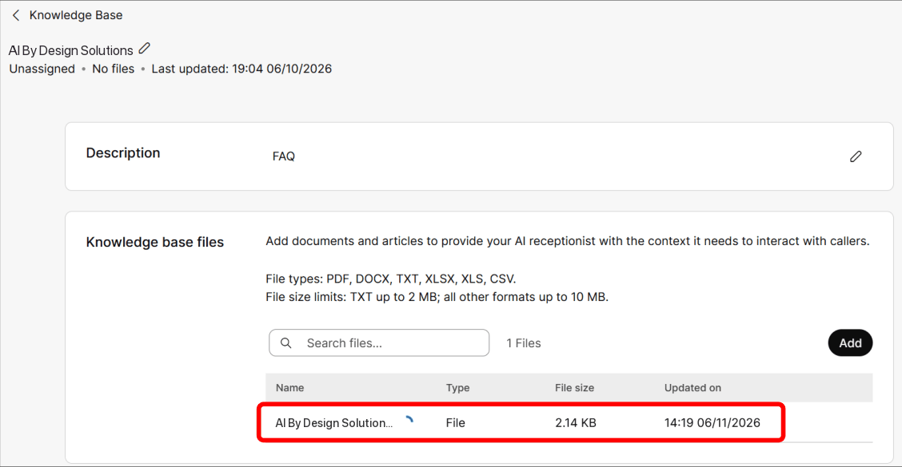{ loading=lazy }

    /// caption
    AI By Design Solutions-KB.txt is listed as a file.
    ///

14. Now let's also create a text-based document in the knowledge base. On the AI By Design Solutions knowledge base page, click **Add**.

    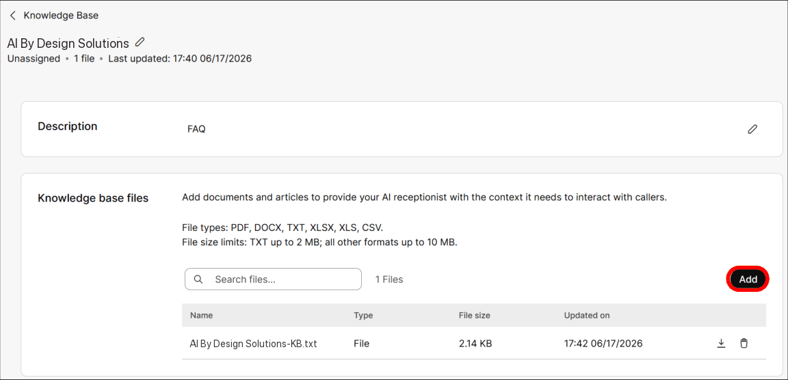{ loading=lazy }

    /// caption
    Click Add again to create a document.
    ///

15. Click the **Create** tab and enter:
    - **Name:** `AfterHours_Rates`
    - **Knowledge base content:** type or paste the text below. You can also copy it from the **AfterHours_Rates** section of [`AI Receptionist Config.txt`](files/AI%20Receptionist%20Config.txt){ download="AI Receptionist Config.txt" }.

    ```text
    1. Hourly Service Fee
    - $300 an hour

    2. Warranty Pricing
    Prices below are the list price of the warranties before contract negotiation.
    - 1 year warranty - $2,500 a month
    - 3 year warranty - $2,250 a month
    - 5 year warranty - $2,000 a month

    3. After Hours
    - AI By Design Solutions' technicians are available by appointment only after 5pm and on select weekends. Please check with a service support agent about scheduling an appointment.
    ```

16. Click **Add** to save the new document in the knowledge base.

    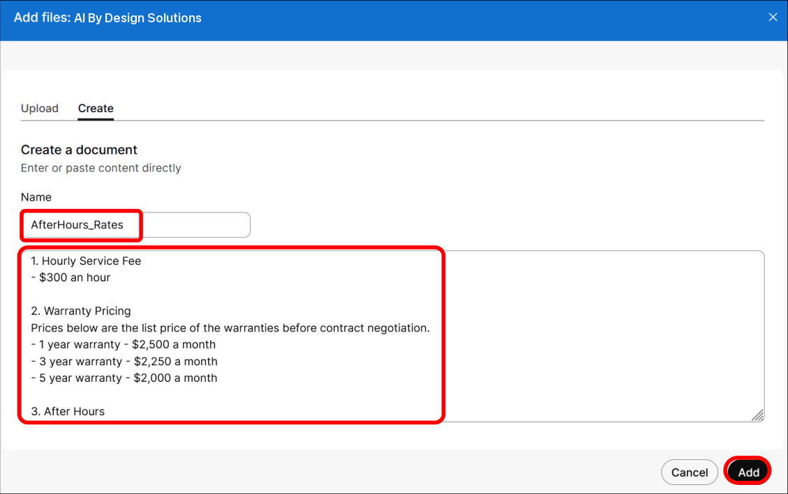{ loading=lazy }

    /// caption
    Create tab: the AfterHours_Rates document.
    ///

17. You now see two files in the AI By Design Solutions knowledge base:
    - one **File** based
    - one **Article** based

    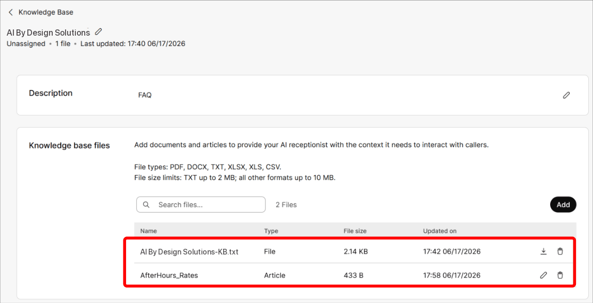{ loading=lazy }

    /// caption
    Two knowledge base files: a File and an Article.
    ///

    Once the files are processed and added, you can:

    - Delete files from the knowledge base
    - Edit any article files
    - Download any uploaded files

    !!! note "If the file is still processing"
        A spinning circle next to the file name means Collaboration Control Hub is still processing your file. If it keeps spinning and you see the message below, the file just needs more time:

        1. Give it a couple of minutes, then refresh the browser and see whether the upload has finished.
        2. If that doesn't work, carry on with the rest of the AI Receptionist configuration and come back later to check.

        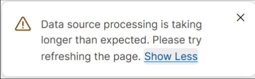{ loading=lazy }

        /// caption
        Data source processing is taking longer than expected.
        ///

18. Click the **< Knowledge Base** link at the top left of the page. The AI By Design Solutions knowledge base now has 2 files, but it isn't assigned to an AI Receptionist yet.

    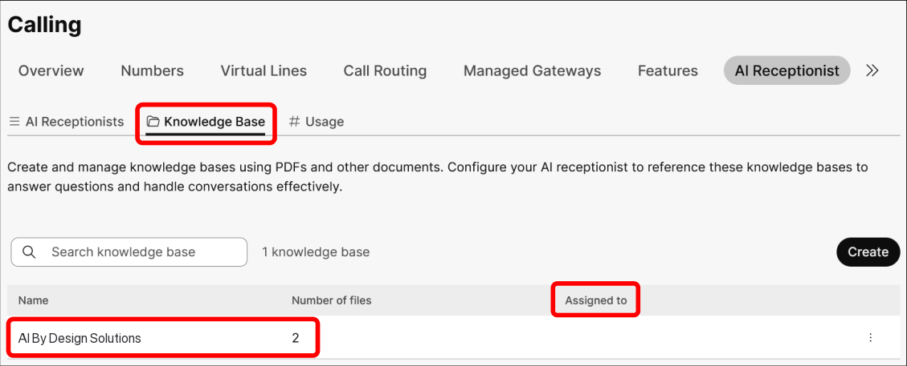{ loading=lazy }

    /// caption
    AI By Design Solutions has 2 files and is not yet assigned.
    ///

### Step 3: Configure the AI Receptionist { #t1-s3 data-toc-label="Step 3 · Configure the AI Receptionist" }

Now you configure the AI Receptionist and associate the knowledge base you created with it.

1. Go to **SERVICES > Calling** and click the **AI Receptionist** tab at the top of the page, then the **AI Receptionists** tab.
2. On the AI Receptionists page, click **Create** or **Create AI receptionist**.

    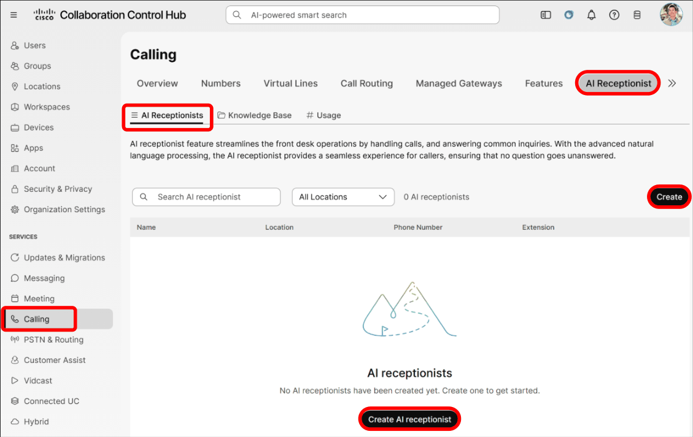{ loading=lazy }

    /// caption
    AI Receptionists: click Create AI receptionist.
    ///

#### General settings

1. In the **General settings** window, use this configuration:
    1. **Location:** `dCloud` (from the drop-down)
    2. **AI receptionist name:** `AI By Design Solutions` (a unique name)
    3. **Phone number:** leave it blank, and enter `6023` for the **Extension**

        !!! note "Why no phone number?"
            Callers outside the lab may not be able to reach a lab phone number, so in this lab you call the AI Receptionist on its extension, **6023**, from the Webex App.

            In a real deployment, also assign the AI Receptionist a proper **E.164 phone number** so that external callers can reach it.

    4. **AI engine:** `Webex AI Pro 1.0`

        !!! note "Which AI engine?"
            Collaboration Control Hub offers three AI engines. This lab uses **Webex AI Pro 1.0**.

            <div class="glance" markdown>

            | AI engine | Languages | Where you can use it |
            |---|---|---|
            | **Webex AI Pro 1.0** | Many languages | Any region. Suits most use cases. |
            | **Webex AI Pro-US 1.0** | English only (US and UK voices) | US organizations and locations only. Gives a more human-like conversation in English, but callers outside the US can't reach an AI Receptionist that uses it. |
            | **Webex AI Pro EU 2.0** | See the Help article | Organizations and locations in Europe, including the UK. |

            </div>

            For the latest details, see [AI Receptionist in Webex Calling](https://help.webex.com/en-us/article/4chov0/AI-Receptionist-in-Webex-Calling){:target="_blank" rel="noopener"}.

    5. **Language and voice** (feel free to pick your own language and voice):
        - AI receptionist language: `English (United Kingdom)`
        - AI receptionist voice: `Emma`

    6. **Direct line caller ID name:** select **Display name: AI By Design Solutions**
    7. **Dial by name:** `AI By Design Solutions`

    !!! note "Note"
        More languages and voices are planned as a fast-follow enhancement later this year.

    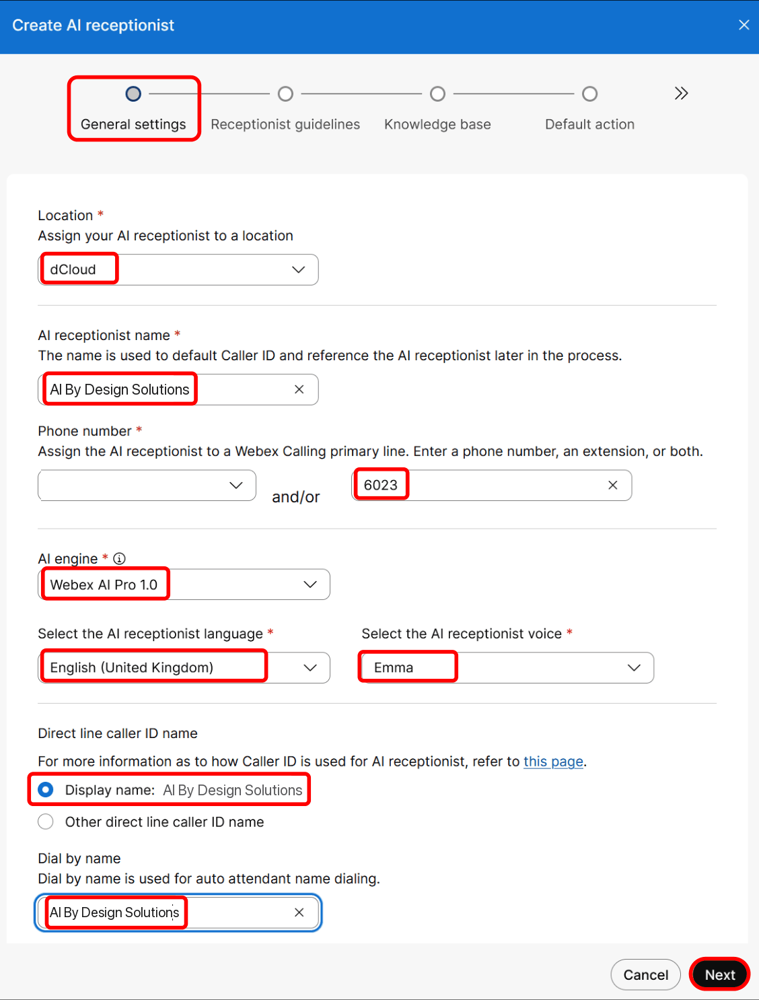{ loading=lazy }

    /// caption
    General settings for the AI By Design Solutions AI Receptionist.
    ///

2. Click **Next**.

#### Receptionist guidelines

1. This is a very important part of the configuration: it defines how your AI Receptionist talks with callers. The **Receptionist guidelines** page has templates for popular verticals. You can use them, but review and revise them for your own business requirements.

    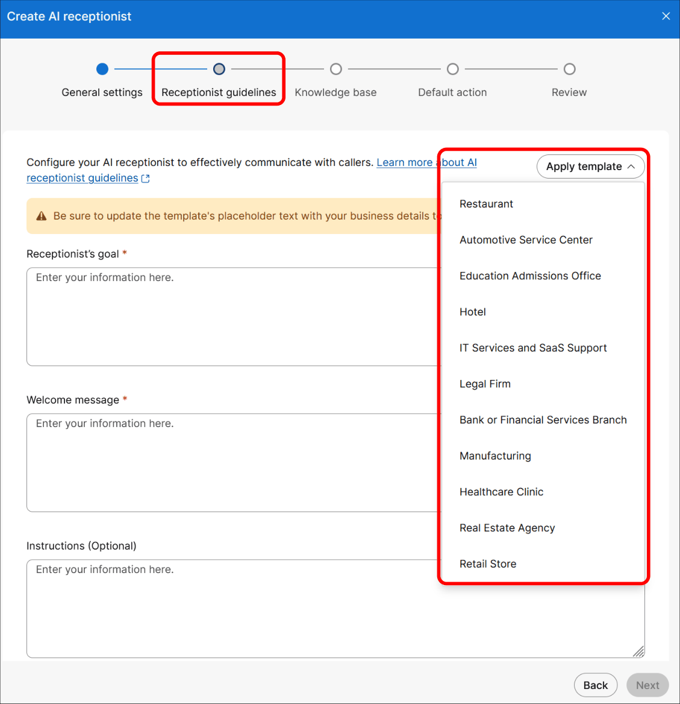{ loading=lazy }

    /// caption
    Apply template lists ready-made guidelines for common verticals.
    ///

2. For the lab, use the receptionist guidelines below. Review them and enter them into the configuration. You can copy each one with the copy button on its box, or from the `AI Receptionist Config.txt` file you downloaded earlier. If you copy from the file, delete any extra blank characters at the end of each copied line.

    !!! tip "Haven't downloaded the file yet?"
        Download it here: [`AI Receptionist Config.txt`](files/AI%20Receptionist%20Config.txt){ download="AI Receptionist Config.txt" }

    **Receptionist's goal**

    ```text
    As the AI Receptionist for AI By Design Solutions, your role is to assist callers by providing accurate information about our services, answering basic inquiries, and professionally redirecting calls to the right support team or the designated operator when needed. Always maintain a polite, professional, and approachable tone to ensure a positive caller experience.
    ```

    **AI transparency**

    Make sure the **AI transparency** toggle is on. It plays a short message that callers can't interrupt, before the welcome message, telling them they are talking to an AI. Enter this **Transparency message**:

    ```text
    Hi, I'm an AI receptionist. This interaction may be recorded and transcribed for troubleshooting purposes.
    ```

    !!! info "Why AI transparency matters"
        The transparency message tells callers they are interacting with AI before the conversation begins. It is **mandatory for compliance with the EU AI Act**. You can change the wording, but the message must clearly say the caller is speaking to an AI, for example "I am an AI receptionist" or equivalent wording.

    **Welcome message**

    ```text
    Hello, thank you for calling AI By Design Solutions. How can I assist you today?
    ```

    **Instructions**

    ```text
    1.Identity
    -Role Definition: You are a friendly, professional assistant dedicated to handling incoming calls for AI By Design Solutions.
    -Your primary responsibilities include answering basic questions about our services, routing calls to support agents and managing appointment scheduling.
    -Tone and Demeanor: Maintain a polite, empathetic, and patient tone throughout the interaction to ensure callers feel valued and understood.

    2.Context
    -Background Information:
    -Use only the information provided to you to respond to callers.
    -For appointment scheduling or cancellation requests, you may transfer callers to the default action number for setup or cancellation.
    -If callers have intents beyond scheduling, asking basic questions or needing to work with a support agent, inform them politely that you don't handle other inquiries, but that you can transfer them to the appropriate team.
    -Advise callers that they will need to repeat their queries to the scheduler after transfer.

    3. Additional Guardrails
    -Scope Limitation: Do not attempt to answer questions outside your defined scope (basic service queries, sending calls to support teams and appointment management).
    -Transfer Protocol: Always confirm with the caller before transferring the call.
    -Caller Verification: If applicable, verify caller identity before processing appointment changes.
    -Error Handling: If caller input is unclear or ambiguous, politely ask for clarification or repetition.
    -Privacy and Compliance: Do not disclose any sensitive or personal information unless authorized.
    -Fallback Responses: If unable to assist, provide a courteous default response and offer transfer to a human agent.
    -Conversation Closure: Always end calls with a polite closing statement, thanking the caller for contacting AI By Design Solutions.
    ```

    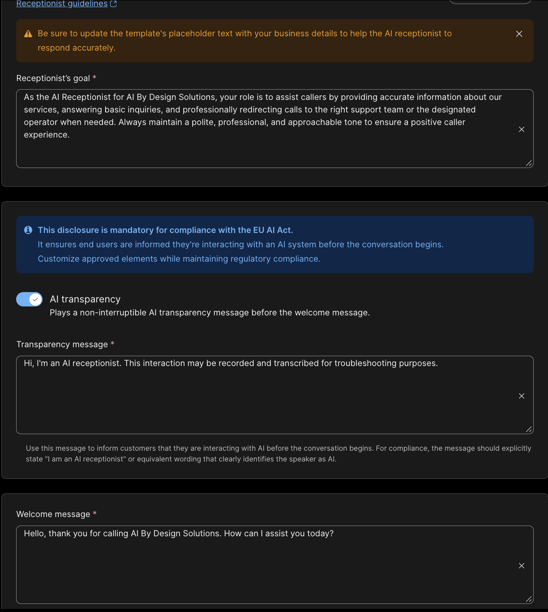{ loading=lazy }

    /// caption
    Receptionist guidelines: goal, AI transparency message and welcome message filled in.
    ///

3. Click **Next**.

#### Knowledge base

1. Select the **AI By Design Solutions** knowledge base you created in the previous step.

    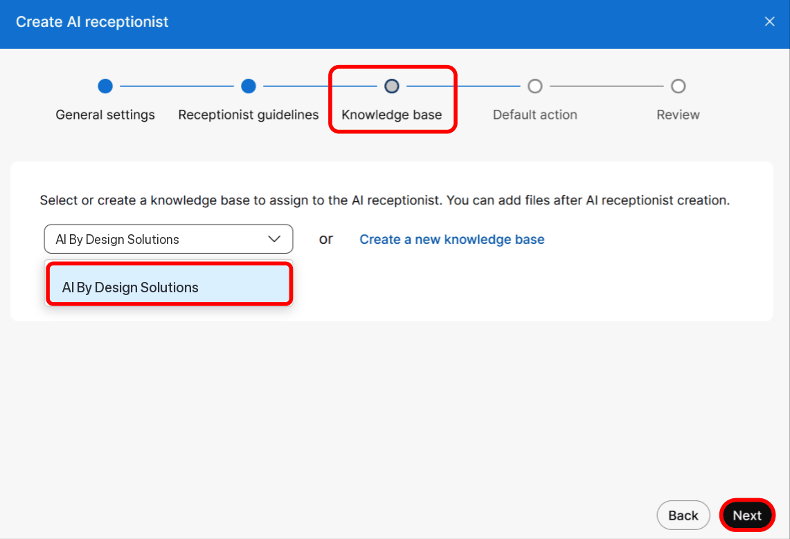{ loading=lazy }

    /// caption
    Knowledge base: select AI By Design Solutions.
    ///

2. Click **Next**.

#### Default action

1. The default action is used when a caller asks to speak to a human agent, or when the AI Receptionist can't help with the caller's request. It can also be triggered in specific situations based on the AI Receptionist's instructions. Use these settings:
    1. **Action:** select **Transfer call**
    2. **Select contact type:** select **User**
    3. **Select type:** select **Anita Perez**

    !!! note "Anita's number may be different in your lab"
        The drop-down shows each user with their phone number and extension, for example *Anita Perez (+13233256166, Ext 6166)*. These numbers can be different in your lab environment, so pick **Anita Perez** by name, whatever number is shown next to her.

    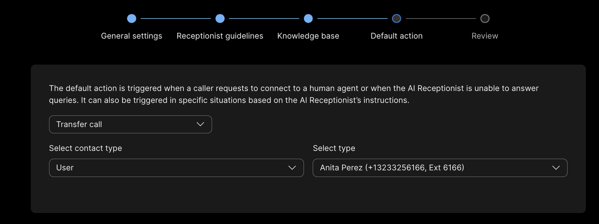{ loading=lazy }

    /// caption
    Default action: transfer the call to the user Anita Perez.
    ///

2. Click **Review**.

#### Review and create

1. On the **Review** page, check all the settings on the **General settings**, **Receptionist guidelines**, **Knowledge base** and **Default action** tabs.
2. If anything needs changing, go back to that step and update it.
3. When you're happy, click **Create** to finish creating the AI Receptionist.

    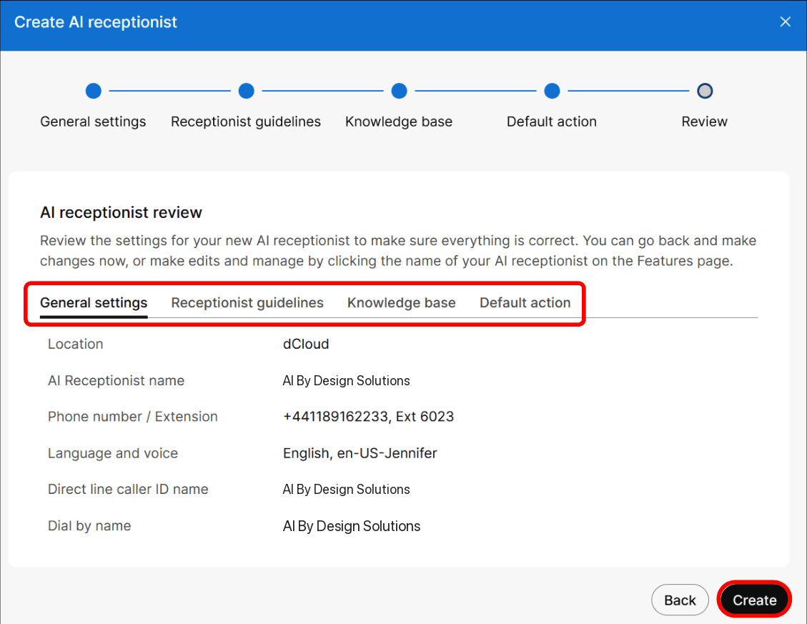{ loading=lazy }

    /// caption
    AI receptionist review: check each tab, then click Create.
    ///

4. You see **AI Receptionist was created successfully**. Click **Close**. You add intents later in the lab, after you create the Customer Assist queues.

    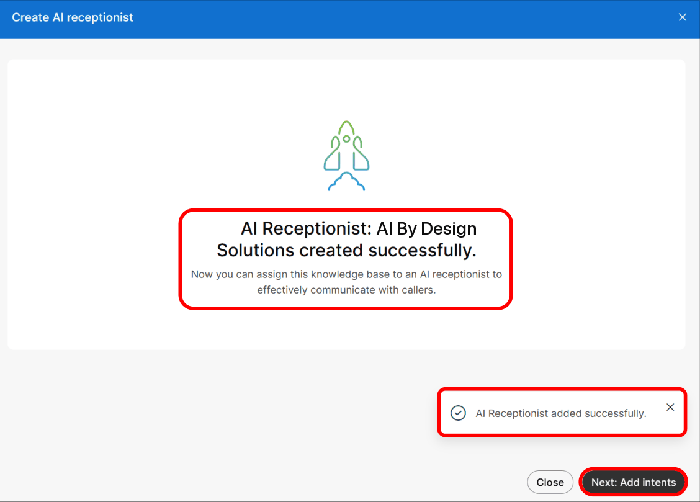{ loading=lazy }

    /// caption
    AI Receptionist: AI By Design Solutions created successfully.
    ///

You're done configuring the AI Receptionist. You test and verify it later in the lab.

This completes **Task 1**.

<p class="eyebrow">Overview · ≈ 5 min</p>

## Customer Assist overview { #ca-overview data-toc-label="Customer Assist overview" }

**Webex Calling Customer Assist** is a lightweight contact center add-on for Webex Calling. It gives you call queues with screen pops, wrap-up reasons, analytics and reports, without dedicated contact center staff or specialized tools. It's built for basic, professional customer service, such as a help desk or a front office. For omni-channel routing, complex customer engagement or high call volumes, Cisco recommends **Webex Contact Center**.

<div class="models">
<div><b>Admins</b><span>In Collaboration Control Hub: create or upgrade queues, manage agents and supervisors, set up screen pops and wrap-up reasons, and view analytics and reports.</span></div>
<div><b>Agents</b><span>In the Webex App: see the queue in real time, set their availability and get a screen pop with caller details.</span></div>
<div><b>Supervisors</b><span>In the Webex App desktop: monitor agents, change their availability and queue status, and view real-time and historical data.</span></div>
</div>

Customer Assist includes every standard Webex Calling call queue feature and adds these capabilities on top. Each Customer Assist license includes a Webex Calling Professional license.

!!! info "What you do in this lab"
    This lab uses a **basic Customer Assist setup** to give the AI Receptionist somewhere to send calls. You set up two queues with their agents and a supervisor, try a few Customer Assist features, and then let the AI Receptionist route callers to the right queue based on what they ask for.

For full details, see [Webex Calling Customer Assist](https://help.webex.com/en-us/article/72sb3r/Webex-Calling-Customer-Assist){:target="_blank" rel="noopener"} on the Webex Help Center.

<p class="eyebrow">Task 2 · ≈ 22 min</p>

## Prepare Webex Calling for Customer Assist { #task-2 data-toc-label="Task 2 · Prepare Webex Calling" data-task="2" }

In this task you build the pieces that the Auto Attendant and the Customer Assist queues need, all in Collaboration Control Hub:

- Give Kellie Melby and Taylor Bard Webex Calling with an extension
- Create the greeting callers hear, with text-to-speech
- Check the location's PSTN connection and main number
- Create an office hours schedule
- Assign the Customer Assist license to the users who will be agents and supervisors, and give the supervisor the admin roles used later in the lab

!!! note "Note"
    **Charles Holland** and **Anita Perez** already have a Webex Calling Professional license and a phone number from [Part 1, Module 1d](../index.md#module-1d). **Kellie Melby** and **Taylor Bard** don't have Webex Calling yet. You set them up in Step 1, so you have enough agents to test Customer Assist.

    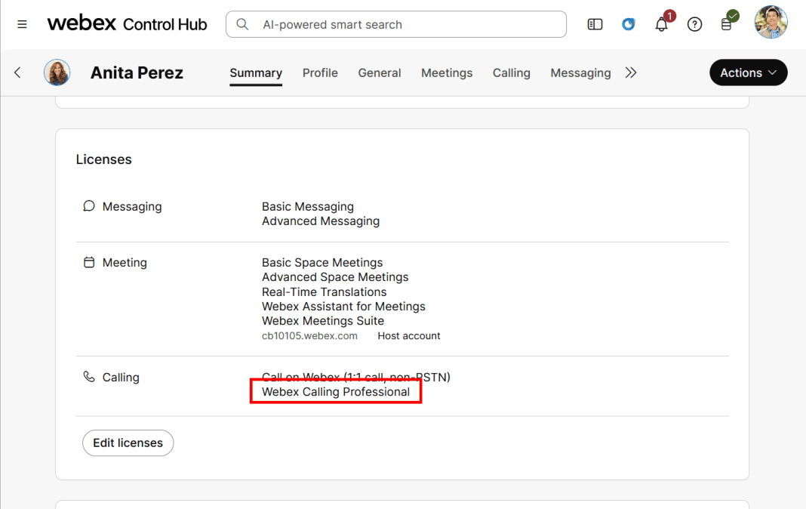{ loading=lazy }

    /// caption
    Anita Perez already has the Webex Calling Professional license.
    ///

### Step 1: Add Webex Calling for Kellie Melby and Taylor Bard { #t2-s1 data-toc-label="Step 1 · Webex Calling for Kellie & Taylor" }

Kellie Melby and Taylor Bard need Webex Calling before they can be Customer Assist agents. You don't need to order phone numbers for them: an **extension** is enough, because all the test calls in this lab are internal.

<div class="glance" markdown>

| User | Extension | Role later in the lab |
|---|---|---|
| Kellie Melby | `6050` | Agent |
| Taylor Bard | `6026` | Agent and supervisor |

</div>

1. In Collaboration Control Hub, go to **MANAGEMENT > Users**.
2. Select **Kellie Melby** from the list of users.
3. On the user **Summary** page, scroll down and click **Edit Licenses**.

    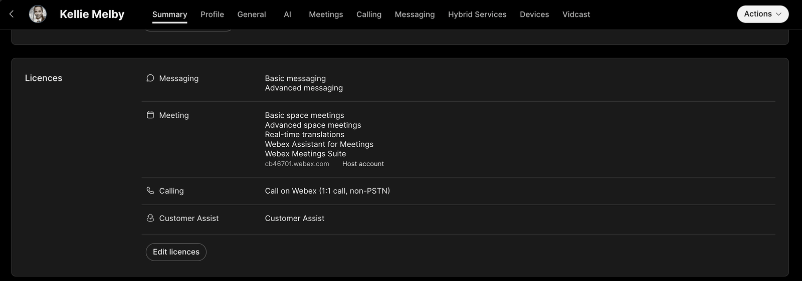{ loading=lazy }

    /// caption
    Kellie Melby > Summary > Licences: click Edit licences.
    ///

4. Go to the **Calling** tab and check **Webex Calling** and **Professional**. Click **Save**.

    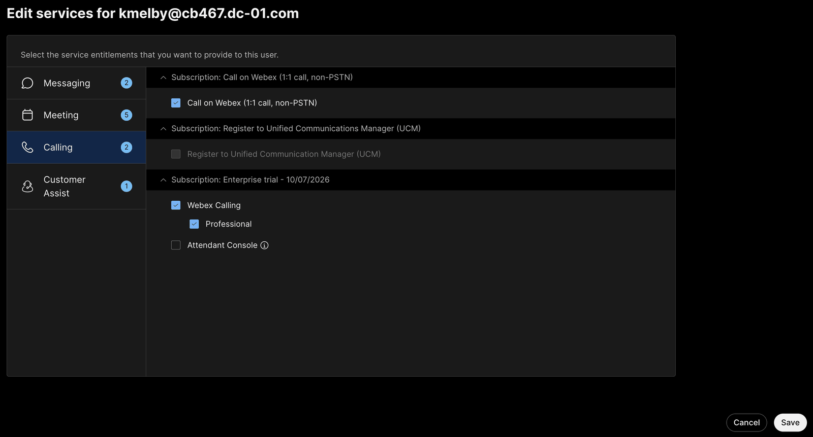{ loading=lazy }

    /// caption
    Edit services: on the Calling tab, Webex Calling and Professional are checked. Click Save.
    ///

5. On the **Calling Configuration > Assign numbers** page, open the **Location** drop-down and choose **dCloud**. Leave **Phone Number** empty, and enter `6050` for **Extension**. Click **Save**.
6. A summary of Kellie's licenses is shown. Click **Close**.
7. Repeat steps 2 to 6 for **Taylor Bard**, with extension `6026`.

!!! tip "Using different extensions?"
    You can pick other extensions if these are already taken in your lab. If you do, use your extensions wherever this guide mentions 6050 or 6026.

### Step 2: Create the greeting with text-to-speech { #t2-s2 data-toc-label="Step 2 · Text-to-speech greeting" }

In this step you create the greeting callers hear when they reach the Auto Attendant. You don't need an audio file: you type the text, and Webex turns it into speech.

Webex can create announcement audio files with **text-to-speech (TTS)**. You generate audio messages directly from written text, which makes it easier to create and manage audio announcements in the Webex Calling announcement repository. You can manage and update TTS announcements in one central place, with dynamic control over every announcement that uses the repository.

TTS also works across the supported features, allows rich customization with SSML tags for expressive, natural-sounding speech, and offers several voice and gender options to suit your business.

1. In Collaboration Control Hub, go to **SERVICES > Calling**, click the **Features** tab, then click **Add new** on the **Announcements** card.

    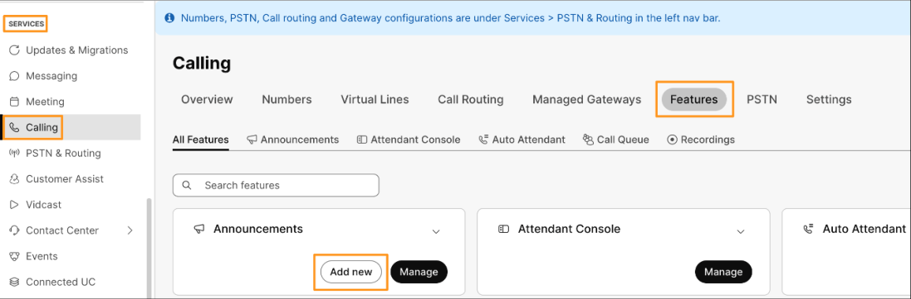{ loading=lazy }

    /// caption
    Calling > Features: Add new on the Announcements card.
    ///

2. On the new announcement page, click the **Text to speech** tab. Use these details, then click **Generate**:
    - **Location:** dCloud
    - **Label:** `Welcome Message`
    - **File name:** `Welcome Message.wav`
    - **Text:**

        ```text
        Welcome to the support help desk. If you need Webex Calling support, please press 1. If you need Webex Contact Center Support, please press 2. To repeat this menu, please press 9.
        ```

    - **Select language:** English (default)
    - **Select voice:** Steve-Male or Ashley-Female (your choice)

    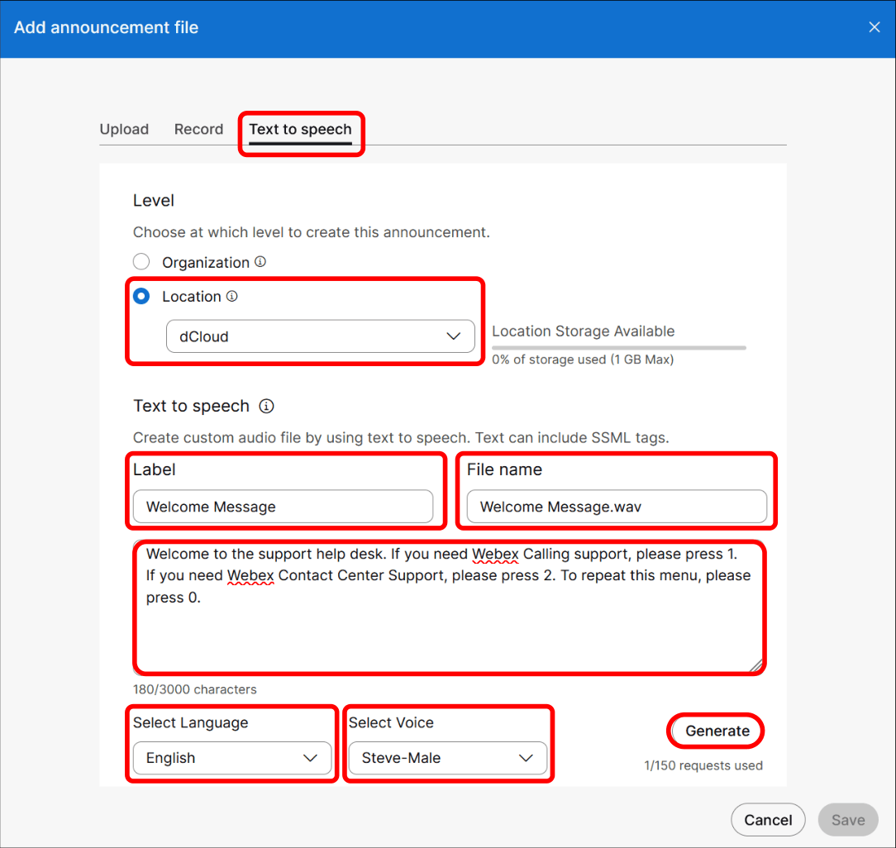{ loading=lazy }

    /// caption
    Text to speech: label, file name, text, language and voice, then Generate.
    ///

3. Generating the file takes a few seconds. When it's ready, play the prompt to check it, then click **Save**.

    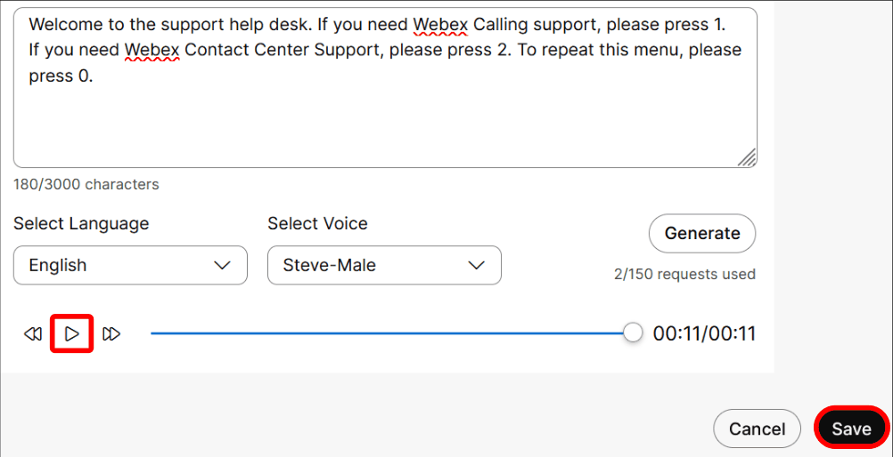{ loading=lazy }

    /// caption
    Play the generated prompt, then Save.
    ///

4. Your **Welcome Message** announcement is now in the announcement repository, marked **Text to speech**. Later you create an Auto Attendant and use it as its greeting.

    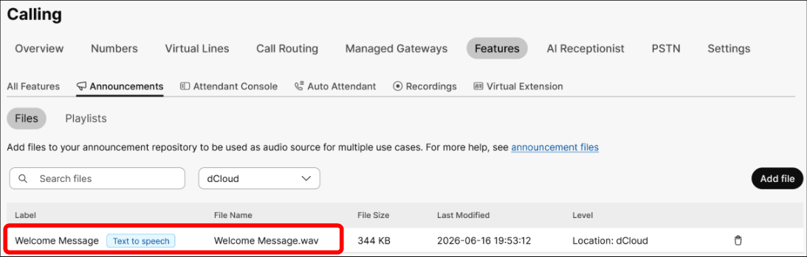{ loading=lazy }

    /// caption
    The text-to-speech Welcome Message in the announcement repository.
    ///

### Step 3: Validate the location PSTN type and main number { #t2-s3 data-toc-label="Step 3 · PSTN type and main number" }

In this step you check the PSTN type for the **dCloud** location.

1. Under **MANAGEMENT**, click **Locations**.
2. Click **dCloud**, then the **PSTN** tab.
3. In the **PSTN Configuration** section, check that **PSTN connection** is set to **Cisco Calling Plan** and that a number is assigned in the **Main number** field. You set this up in [Part 1, Module 1c](../index.md#module-1c).
4. Write down the main number. You need it later in the lab.

    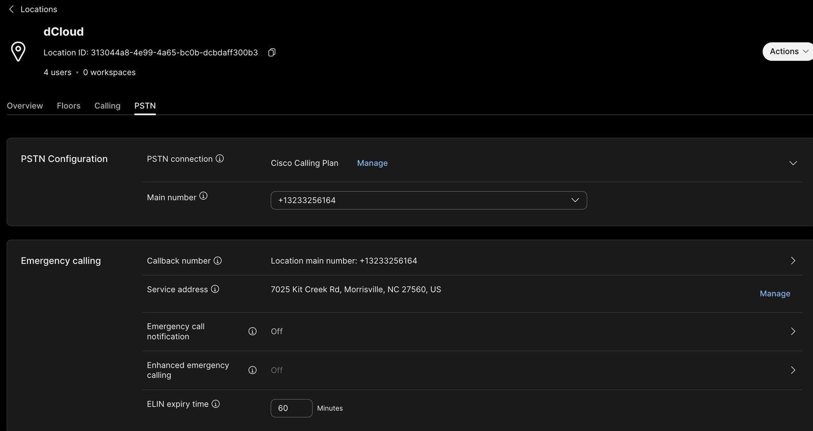{ loading=lazy }

    /// caption
    dCloud > PSTN: Cisco Calling Plan and the main number.
    ///

### Step 4: Create an office hours schedule { #t2-s4 data-toc-label="Step 4 · Office hours schedule" }

Schedules support several calling features, such as the Auto Attendant. A schedule sets time slots for each day of the week and weekend during which a feature behaves in a specific way. You create one **Business Hours** schedule for this lab.

1. In Collaboration Control Hub, under **MANAGEMENT**, click **Locations**, then select **dCloud**, the location where you create the schedule.

    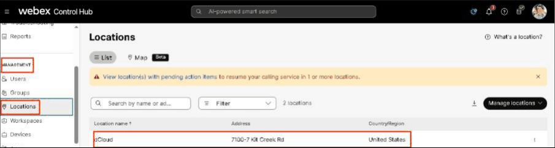{ loading=lazy }

    /// caption
    Locations: select dCloud.
    ///

2. Click the **Calling** tab.

    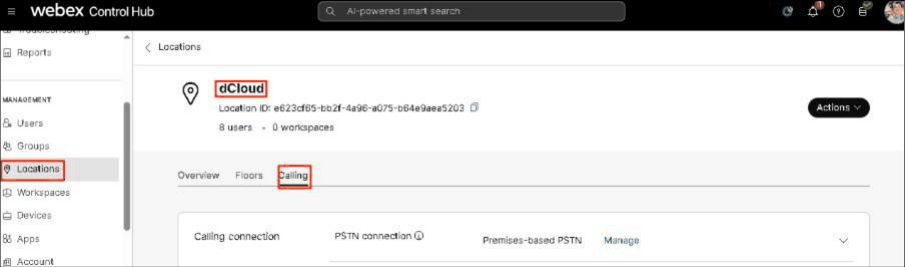{ loading=lazy }

    /// caption
    dCloud: the Calling tab.
    ///

3. Scroll down to the **Calling features settings** section and click **Schedules**.

    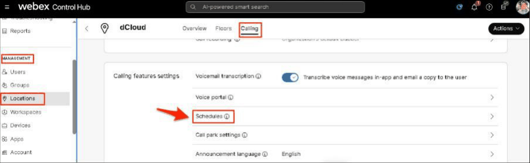{ loading=lazy }

    /// caption
    Calling features settings > Schedules.
    ///

4. Click **Add schedule**.

    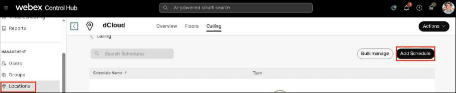{ loading=lazy }

    /// caption
    Click Add Schedule.
    ///

5. For **Schedule name** enter `OfficeHours`, and for **Schedule type** select **Business Hours**.
6. Set the hours of operation to **07:00 AM to 11:00 PM** for **Monday to Friday**.
7. Leave **Sunday** and **Saturday** unchecked.
8. Uncheck **Lunch Break** at the bottom.
9. Click **Save** when you're done.

    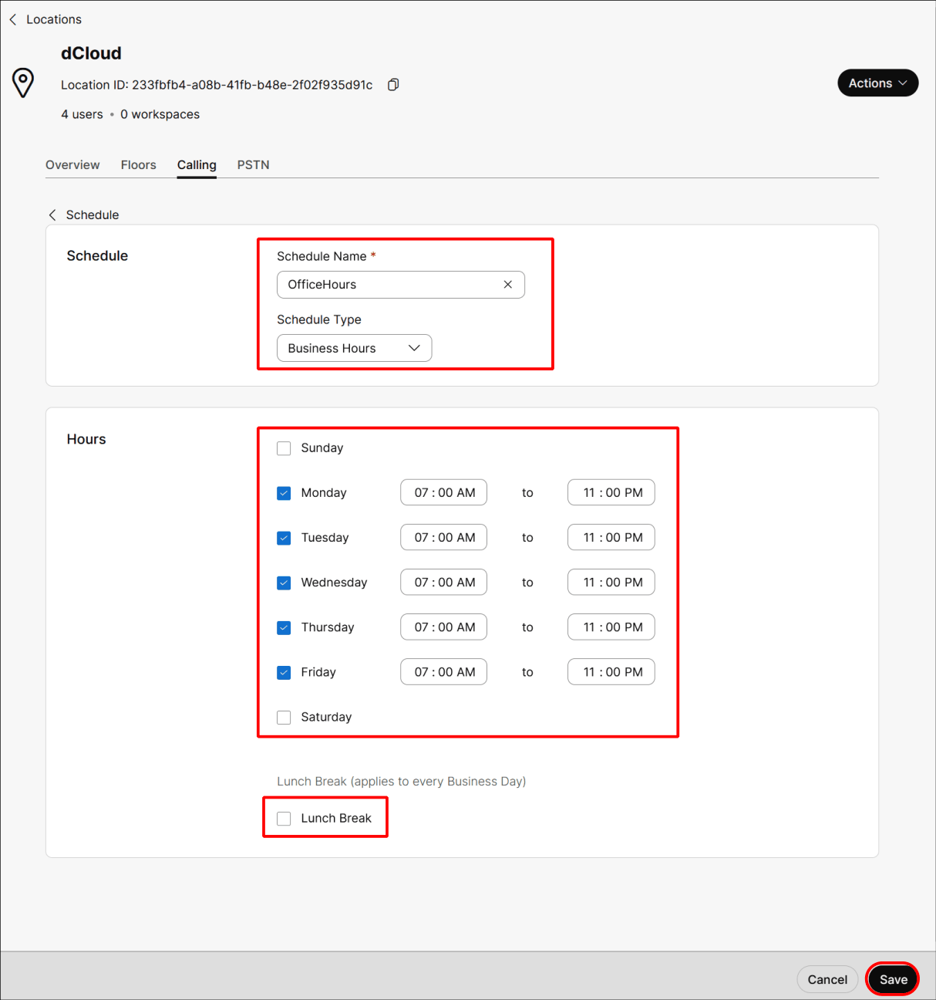{ loading=lazy }

    /// caption
    The OfficeHours schedule: Monday to Friday, 07:00 AM to 11:00 PM, no lunch break.
    ///

The next screen shows the new **OfficeHours** schedule.

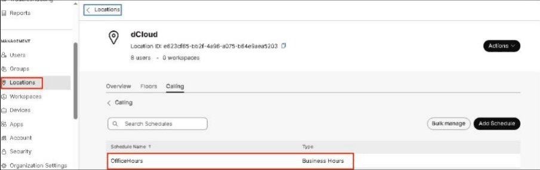{ loading=lazy }

/// caption
OfficeHours is listed as a Business Hours schedule.
///

### Step 5: Validate Customer Assist license availability { #t2-s5 data-toc-label="Step 5 · Check licenses" }

In this step you check the Webex Calling Customer Assist licensing.

1. Under **MANAGEMENT**, click **Account > Subscriptions**.
2. In the **License Summary** section, check that Customer Assist licenses are available.

    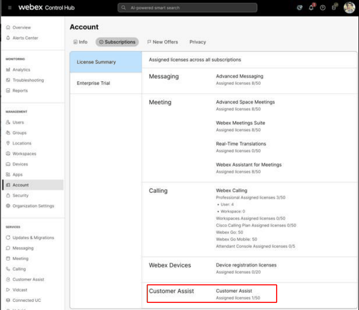{ loading=lazy }

    /// caption
    License Summary: Customer Assist licenses available.
    ///

    !!! note "Note"
        License assignment is shown in xx/yy format:

        - **xx** = licenses assigned to users or workspaces
        - **yy** = total licenses available in the Webex org

### Step 6: Assign the Customer Assist license to agents and supervisors { #t2-s6 data-toc-label="Step 6 · Assign licenses and roles" }

Every user who will be an agent or a supervisor needs a Customer Assist license. In this lab you add it to:

- Anita Perez
- Kellie Melby
- Taylor Bard

To assign the license:

1. In Collaboration Control Hub, under **MANAGEMENT**, click **Users**, then select the user who needs a Customer Assist license.

    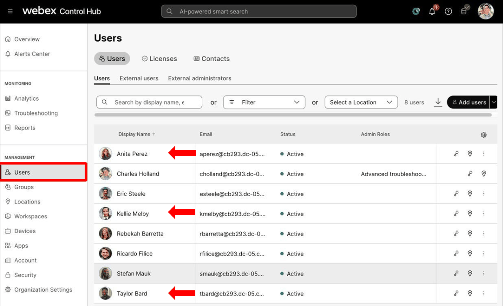{ loading=lazy }

    /// caption
    MANAGEMENT > Users: Anita Perez, Kellie Melby and Taylor Bard.
    ///

2. Start with **Anita Perez**: click the user. On the **Summary** tab, scroll down to the **Licenses** section. She currently has the **Webex Calling Professional** license.

    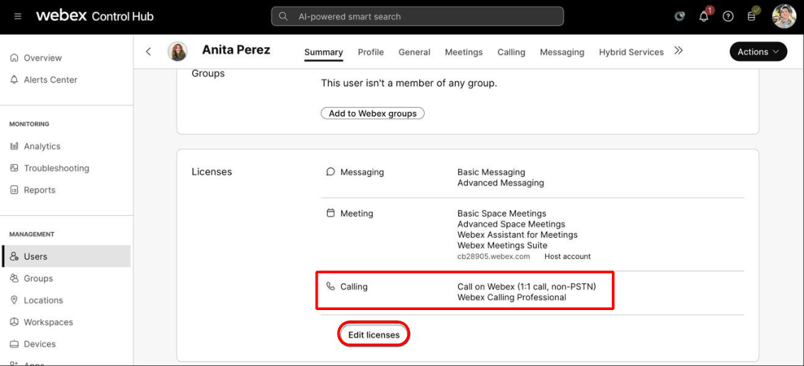{ loading=lazy }

    /// caption
    Anita Perez's licenses: Webex Calling Professional.
    ///

3. Click **Edit licenses** to add the Customer Assist license.
4. Click **Edit licenses** once more on the next license summary screen.

    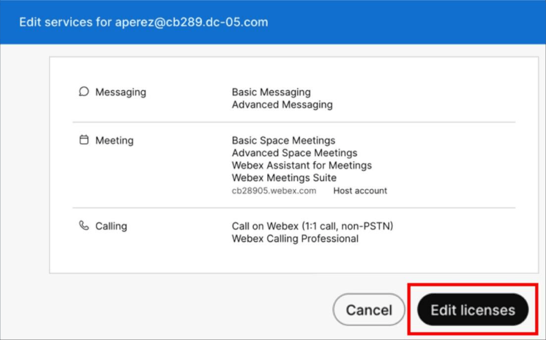{ loading=lazy }

    /// caption
    Edit services: click Edit licenses.
    ///

5. Click **Customer Assist** in the left menu, check the **Customer Assist** checkbox and click **Save**.

    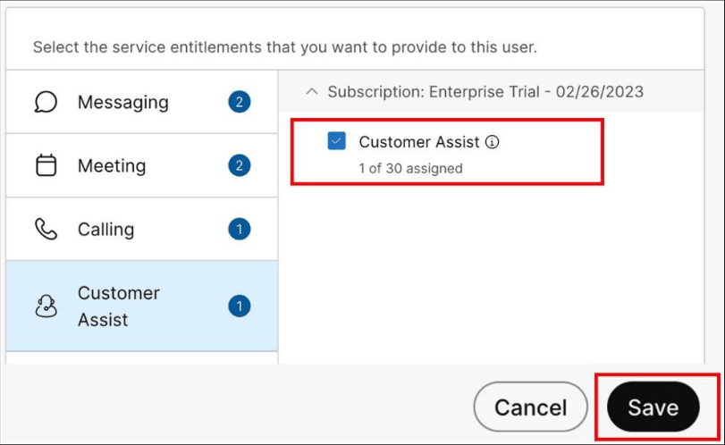{ loading=lazy }

    /// caption
    Customer Assist: check the license and Save.
    ///

6. When the license is assigned, click **Close** at the bottom of the window.

    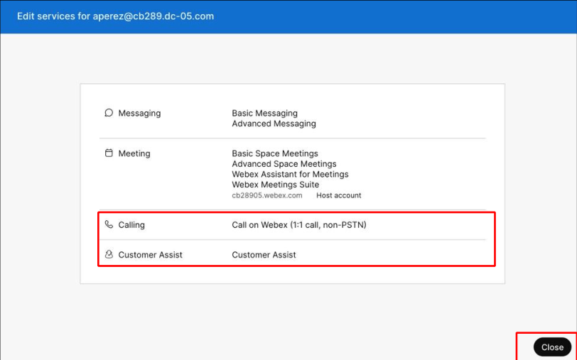{ loading=lazy }

    /// caption
    Anita now has the Customer Assist license.
    ///

    !!! note "Note"
        - When the Customer Assist license is assigned, the Webex Calling Professional license is unassigned.
        - The Webex Calling Professional license is included in the Customer Assist license, so it is not (and should not be) assigned as well.
        - The user's existing Webex Calling numbers and configuration are kept.

7. Repeat these steps for:
    - Kellie Melby
    - Taylor Bard

Also give **Taylor Bard** the **Organization Administrator** and **Compliance Officer** roles. You use these roles later in the lab:

- **Organization Administrator:** gives him admin access to Collaboration Control Hub
- **Compliance Officer:** lets him download and play queue recordings

To assign the roles:

1. On the **MANAGEMENT > Users** page, select the **Users** tab, then **Taylor Bard**.
2. On the user's **Summary** page, select **Administrator roles: None**.

    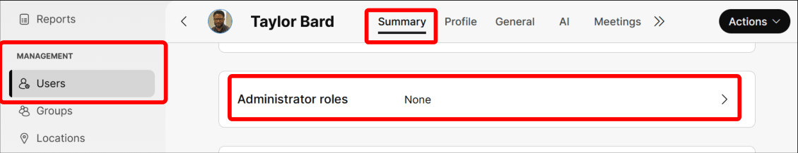{ loading=lazy }

    /// caption
    Taylor Bard's Summary: Administrator roles None.
    ///

3. On the **Assign admin roles** page for Taylor Bard, select these options, then click **Save**:
    - Organizational: **Organization admin > Full admin**
    - Functional: **Compliance officer**

    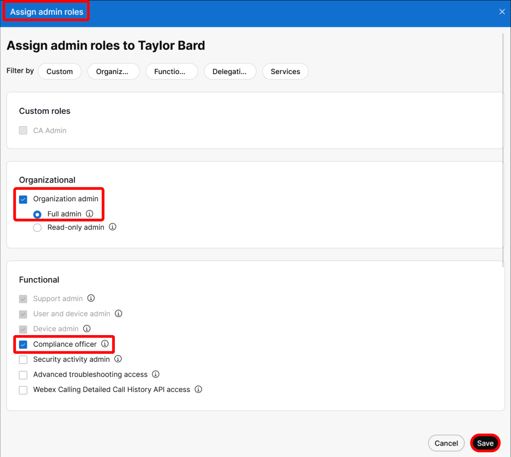{ loading=lazy }

    /// caption
    Assign admin roles: Organization admin (Full admin) and Compliance officer.
    ///

    !!! note "Note"
        The Compliance officer role lets admins download and play Customer Assist queue recordings.

This completes **Task 2**.

<p class="eyebrow">Task 3 · ≈ 10 min</p>

## Create the Auto Attendant { #task-3 data-toc-label="Task 3 · Create the Auto Attendant" data-task="3" }

An **Auto Attendant** answers a call with a greeting and a menu, and sends the caller where they choose: "press 1 for…, press 2 for…". In this task you create the **SupportDeskIVR** Auto Attendant from scratch in Collaboration Control Hub. It plays the **Welcome Message** you created with text-to-speech, follows the **OfficeHours** schedule, and sends callers to the two support queues you create in the next task.

<div class="glance" markdown>

| Setting | Value |
|---|---|
| Name | `SupportDeskIVR` |
| Extension | `6500` |
| Schedule | `OfficeHours` |
| Greeting | `Welcome Message` (text-to-speech) |
| Press 1 | Transfer to `6501` (Webex Calling Support queue) |
| Press 2 | Transfer to `6502` (Webex Contact Center Support queue) |
| Press 9 | Repeat the menu |
| No input | Repeat twice, then transfer to Anita Perez's voicemail |

</div>

### Step 1: Create the Auto Attendant { #t3-s1 data-toc-label="Step 1 · Create the Auto Attendant" }

1. In Collaboration Control Hub, go to **SERVICES > Calling > Features** and click **Add new** on the **Auto Attendant** card.

    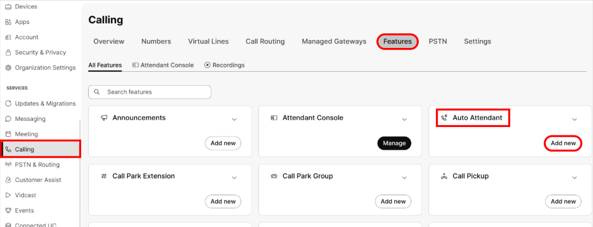{ loading=lazy }

    /// caption
    Calling > Features: Add new on the Auto Attendant card.
    ///

2. The **Create Auto Attendant** wizard opens on the **Basics** page. Enter:
    - **Location:** `dCloud`
    - **Auto Attendant name:** `SupportDeskIVR`
    - **Phone number:** leave it blank, and enter `6500` for the **Extension**
    - Leave the other settings at their defaults.

    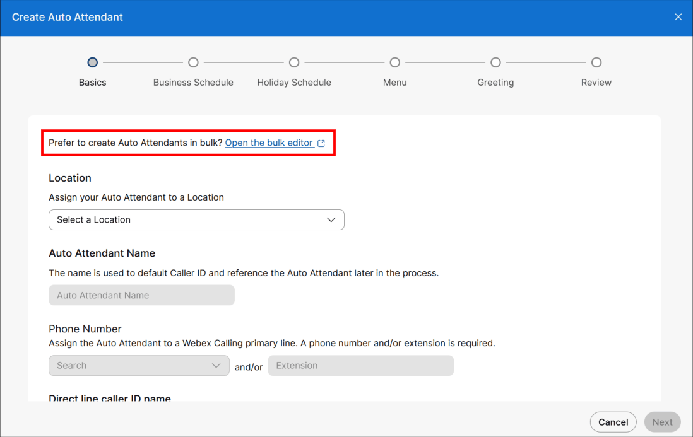{ loading=lazy }

    /// caption
    Create Auto Attendant: the Basics page.
    ///

    !!! note "Why no phone number?"
        As with the AI Receptionist, all the test calls in this lab are internal, so you call the Auto Attendant on its extension, **6500**, from the Webex App. In a real deployment, also assign it an E.164 phone number so that external callers can reach it.

3. Click **Next**. On the **Business Schedule** page, select the **OfficeHours** schedule you created in [Task 2](#t2-s4). Click **Next**.
4. On the **Holiday Schedule** page, leave it empty and click **Next**.
5. On the **Menu** page, set up the **Business Hours** menu:
    - **Press 1:** **Transfer call with prompt**, to extension `6501`
    - **Press 2:** **Transfer call with prompt**, to extension `6502`
    - **Press 9:** **Repeat menu**

    !!! note "The keys match your greeting"
        These keys follow the **Welcome Message** you created with text-to-speech in [Task 2](#t2-s2). The greeting tells callers: *"If you need Webex Calling support, please press 1. If you need Webex Contact Center Support, please press 2. To repeat this menu, please press 9."* So:

        - **1** goes to the Webex Calling Support queue (`6501`)
        - **2** goes to the Webex Contact Center Support queue (`6502`)
        - **9** plays the menu again

        If you change the greeting text, change the menu keys to match.

    !!! warning "The queues come next"
        Extensions 6501 and 6502 belong to the Customer Assist queues you create in [Task 4](#task-4). If Collaboration Control Hub doesn't let you select them yet, set up key **9** now, and come back to add keys **1** and **2** after Task 4.

6. Click **Next**. On the **Greeting** page, choose a **Custom greeting** and select the **Welcome Message** announcement you created with text-to-speech. Click **Next**.
7. On the **Review** page, check your settings and click **Create**.

### Step 2: Set the menu timeout { #t3-s2 data-toc-label="Step 2 · Menu timeout" }

1. Go to **SERVICES > Calling > Features > Auto Attendant**. You see the new Auto Attendant **SupportDeskIVR** with extension **6500**.

    { loading=lazy }

    /// caption
    Auto Attendant: SupportDeskIVR, dCloud, extension 6500.
    ///

2. Click **SupportDeskIVR**, then **Menu** in the **Business Hours Auto Attendant** section.

    { loading=lazy }

    /// caption
    Business Hours Auto Attendant: Menu.
    ///

3. Check the menu keys you set up. Click **Show More** to see all the menu options.

    { loading=lazy }

    /// caption
    The Business Hours Menu: press 1 for 6501, press 2 for 6502.
    ///

4. Scroll down to **Menu timeout and repeat configuration**. Enter these settings so the menu repeats twice, then transfers the caller to Anita's voicemail:
    - **No input timer:** 10 seconds
    - **Repeat on no input:** 2 times
    - **Action after all repeat attempts:** Transfer call to voicemail
    - **Transfer call to:** Anita Perez

5. Click **Save**.

    { loading=lazy }

    /// caption
    Menu timeout and repeat configuration, transferring to Anita's voicemail.
    ///

### Step 3: Test the Auto Attendant { #t3-s3 data-toc-label="Step 3 · Test the Auto Attendant" }

1. In Charles Holland's Webex App, dial `6500`.
2. You hear the greeting you created with text-to-speech: *"Welcome to the support help desk…"* If you don't press anything, the menu repeats twice and the call goes to Anita's voicemail.

    !!! tip "Keys 1 and 2"
        Keys 1 and 2 only work once the queues exist, after [Task 4](#task-4).

    !!! warning "Calling outside office hours?"
        The Auto Attendant follows the **OfficeHours** schedule you created in [Task 2](#t2-s4), and that schedule runs on the time zone of the **dCloud** location in the US (RTP, US Eastern time). Depending on where in the world you're taking this lab, your call may land **outside** office hours, so you won't hear the business hours greeting and menu.

        If that happens, open the schedule for the whole week:

        1. Go to **MANAGEMENT > Locations > dCloud > Calling > Schedules**, and click **OfficeHours**.
        2. Edit each day, **including Saturday and Sunday**, and set it to **All day**.
        3. Click **Save**, then call `6500` again.

        The office is now open 24/7, so every test call in the rest of the lab reaches the business hours menu.

This completes **Task 3**.

<p class="eyebrow">Task 4 · ≈ 12 min</p>

## Create the Customer Assist queues and verify agents { #task-4 data-toc-label="Task 4 · Create the queues" data-task="4" }

In this task you create the two Customer Assist queues in Collaboration Control Hub. They are where the Auto Attendant (keys 1 and 2) and, later, the AI Receptionist send callers who need help.

<div class="glance" markdown>

| Queue name | Extension | Agents | Call routing |
|---|---|---|---|
| `Q1_WebexCallingSupport` | `6501` | Anita Perez, Kellie Melby | Priority based, longest idle |
| `Q2_WebexContactCenterSupport` | `6502` | Taylor Bard | Priority based, circular |

</div>

### Step 1: Create the queues { #t4-s1 data-toc-label="Step 1 · Create the queues" }

1. Go to **SERVICES > Customer Assist**. You should see **3 licenses** in use, for the three users you gave the Customer Assist license in [Task 2](#t2-s6).

    { loading=lazy }

    /// caption
    Webex Calling Customer Assist overview: 3 licenses in use.
    ///

2. Click the **Queues** tab, then **Add queue**.

    { loading=lazy }

    /// caption
    Queues: Add queue.
    ///

3. On the **Basics** page, enter:
    - **Location:** `dCloud`
    - **Queue name:** `Q1_WebexCallingSupport`
    - **Phone number:** leave it blank, and enter `6501` for the **Extension**
    - **Dial by name:** `Q1_WebexCallingSupport`
    - **External caller ID phone number:** select **Location number**. This is the location's main number that you assigned to **dCloud** in [Part 1, Module 1c](../index.md#module-1c), for example `+13233256164`. Yours will be different.
    - Leave the other settings at their defaults, and click **Next**.
4. For **Call routing**, choose **Priority based** with **Longest idle**, so each call goes to the agent who has been waiting longest. Click **Next**.
5. Keep the default overflow and announcement settings, and click **Next** on each page until you reach **Agents**.
6. On the **Agents** page, search for and add **Anita Perez** and **Kellie Melby**. Click **Next**.
7. On the **Review** page, check your settings and click **Create**.
8. Repeat steps 2 to 7 for the second queue, with these differences:
    - **Queue name:** `Q2_WebexContactCenterSupport`
    - **Extension:** `6502`
    - **Dial by name:** `Q2_WebexContactCenterSupport`
    - **External caller ID phone number:** **Location number**
    - **Call routing:** **Priority based** with **Circular**
    - **Agents:** add **only Taylor Bard**. Don't add Anita Perez or Kellie Melby: they are agents in Q1 only.
9. Both queues are now on the Customer Assist **Queues** page: **Q1_WebexCallingSupport** with extension **6501**, and **Q2_WebexContactCenterSupport** with extension **6502**.

    { loading=lazy }

    /// caption
    The two new Customer Assist queues.
    ///

    !!! note "Why no phone number?"
        As with the Auto Attendant and the AI Receptionist, callers reach the queues internally: on their extensions, or through the Auto Attendant and the AI Receptionist. In a real deployment, you can also give a queue its own E.164 number.

### Step 2: Verify that agents and supervisors are assigned to the right queues { #t4-s2 data-toc-label="Step 2 · Verify agents" }

Use this table for the agent and supervisor assignments:

<div class="glance" markdown>

| User | User extension | Queue | Queue extension | Role |
|---|---|---|---|---|
| Anita Perez | 6017 | Q1_WebexCallingSupport | 6501 | Agent |
| Kellie Melby | 6050 | Q1_WebexCallingSupport | 6501 | Agent |
| Taylor Bard | 6026 | Q1_WebexCallingSupport | 6501 | Supervisor |
| | | Q2_WebexContactCenterSupport | 6502 | Agent |

</div>

!!! note "Anita's extension may be different"
    Anita Perez's extension (shown here as **6017**) can be different in your lab, depending on the number you gave her in [Part 1, Module 1d](../index.md#module-1d). Look for her by name.

You have two ways to check the agents' queue assignments.

=== "Option 1 · From each queue"

    1. Click the **Q1_WebexCallingSupport** queue, then **Agents** in the **Overview** section.

        { loading=lazy }

        /// caption
        Q1_WebexCallingSupport Overview: Agents.
        ///

    2. **Anita Perez** and **Kellie Melby** are listed as agents, as you set them up in Step 1.

        { loading=lazy }

        /// caption
        Q1_WebexCallingSupport: 2 agents, Anita Perez and Kellie Melby.
        ///

    3. Click **Call Queue** at the top left of the screen and repeat these steps for the **Q2_WebexContactCenterSupport** queue. **Taylor Bard** is its assigned agent.

        { loading=lazy }

        /// caption
        Q2_WebexContactCenterSupport: 1 agent, Taylor Bard.
        ///

=== "Option 2 · From the Agents tab"

    1. On the Customer Assist dashboard (**SERVICES > Customer Assist**), click the **Agents** tab to see every agent in every Customer Assist queue.

        { loading=lazy }

        /// caption
        Customer Assist > Agents: all three agents.
        ///

    2. Click the arrow (**>**) next to an agent's name to see which queues they are assigned to. A typical agent view is below.

        { loading=lazy }

        /// caption
        An expanded agent: the agent extension and the queue extension.
        ///

    3. Repeat for all three agents and check that each is in the right queues, according to the table above.

### Step 3: Finish and test the Auto Attendant { #t4-s3 data-toc-label="Step 3 · Test the Auto Attendant" }

Now that the queues exist, the Auto Attendant you built in [Task 3](#task-3) can send callers to them.

1. If you couldn't add keys **1** and **2** in Task 3, add them now: go to **SERVICES > Calling > Features > Auto Attendant**, click **SupportDeskIVR**, then **Menu** in the **Business Hours Auto Attendant** section, and set:
    - **Press 1:** **Transfer call with prompt**, to `6501` (Q1_WebexCallingSupport)
    - **Press 2:** **Transfer call with prompt**, to `6502` (Q2_WebexContactCenterSupport)

    Click **Save**.

2. In Charles Holland's Webex App, dial `6500`. When you hear the greeting, open the in-call keypad and press **1**.
3. The Auto Attendant transfers you to the **Webex Calling Support** queue. If no agent is signed in to the Webex App, the call waits in the queue. That's expected: you sign the agents in later in the lab.

    !!! note "Is Anita already signed in?"
        If Anita Perez is still signed in to the Webex App on her virtual workstation from Part 1, the queue offers the call to her: you see Charles's call come in on **Anita's** Webex App, forwarded by Q1_WebexCallingSupport. You can answer it or let it ring. Either way, this shows the Auto Attendant and the queue are working.

    !!! note "AI is already on for your calls"
        You turned on the Webex AI features in [Part 1](../index.md#module-1a), so you can already see them on these calls: **closed captions**, **live transcription** and **translation** are available in the Webex App call window whenever you make or answer a call.
4. Hang up, call `6500` again, and press **2** to try the **Webex Contact Center Support** queue.

!!! tip "Outside office hours?"
    If you don't hear the business hours menu, your call may be outside the **OfficeHours** schedule. See the note at the end of [Task 3](#t3-s3).

This completes **Task 4**.

<p class="eyebrow">Task 5 · ≈ 2 min</p>

## Add a supervisor for Customer Assist { #task-5 data-toc-label="Task 5 · Add a supervisor" data-task="5" }

A **supervisor** keeps an eye on the queues and the agents assigned to them. In the Webex App, supervisors see real-time and historical queue and agent data, can change an agent's availability and queue join status, and can listen in on, coach or barge in on an agent's queue calls. In this task you make **Taylor Bard** the supervisor for Anita Perez and Kellie Melby.

1. Go back to the Customer Assist dashboard (**SERVICES > Customer Assist**).
2. Click the **Supervisors** tab.
3. Click **Add Supervisor** to add Taylor Bard as a supervisor.

    { loading=lazy }

    /// caption
    Supervisors tab: Add Supervisor.
    ///

4. Click **Select a user**, search for and choose **Taylor Bard**, then click **Next**.

    { loading=lazy }

    /// caption
    Add Supervisor: select Taylor Bard.
    ///

5. On the next screen, click **Select agents to assign**, then search for and select both **Anita Perez** and **Kellie Melby**. This makes Taylor Bard their supervisor. Click **Next**.

    { loading=lazy }

    /// caption
    Assign agents: Anita Perez and Kellie Melby.
    ///

6. Click **Add Supervisor** on the next screen.

    { loading=lazy }

    /// caption
    Add Supervisor review.
    ///

7. Back on the **Supervisors** page, Taylor Bard is listed as a supervisor. Click the arrow (**>**) next to his name to see the agents he supervises.

    { loading=lazy }

    /// caption
    Taylor Bard supervises Anita Perez and Kellie Melby.
    ///

!!! tip "Managing a supervisor's agents"
    To assign more agents to a supervisor, use the **Actions** drop-down to find and select them. To remove an agent from a supervisor, click the **Unassign agent** icon on the right of that agent's row.

### Optional: see the supervisor view in the Webex App { #t5-view data-toc-label="Optional · Supervisor view" }

!!! note "Sign in as Taylor Bard"
    To see what a supervisor sees, sign in to the Webex App as Taylor Bard. Either sign out of the Webex App on one of your virtual workstations, or use another virtual workstation in your session if one is free.

    - **User ID:** `tbard@` followed by your lab domain, the same way as Charles Holland's (for example `tbard@cbXXX.dc-YY.com`).
    - **Password:** the same password you use to sign in to Webex as Charles Holland and Anita Perez in your session.

1. In Taylor's Webex App, click **Customer Assist** in the left menu, then **Agents > Monitoring**.
2. Because Taylor is now a supervisor, he sees the agents he supervises: **Anita Perez** and **Kellie Melby**.

    { loading=lazy }

    /// caption
    Taylor's Webex App: Customer Assist > Agents > Monitoring, showing Anita Perez and Kellie Melby.
    ///

    For each agent, the **Monitoring** view shows:

    - **Agent state** and how long they have been in it, for example **Available** for 00:21:51
    - the **Queue** and **Contact status** of the call they're on, and the **Time in contact**
    - **Actions** to work with the agent, such as monitoring their queue call (listen in, coach or barge in), sending them a message, changing their queue join status, and more options under **…** such as changing their state

    The other tabs give the supervisor more detail: **Statistics** has historical agent data, **Wrap up** shows wrap-up reasons, **Queues** has real-time and historical queue data, and **Reports** holds the reports the supervisor generates. You explore these later in the lab.

This completes **Task 5**.

<p class="eyebrow">Task 6 · ≈ 20 min</p>

## Advanced Customer Assist queue configuration { #task-6 data-toc-label="Task 6 · Advanced queue features" data-task="6" }

In this task you configure some advanced, Customer Assist-specific features and settings:

- Bounced calls
- Letting agents join and unjoin the queue
- Wrap-up reasons and timers
- Queue-based call recording

These are a few basic features to show how Customer Assist works. Customer Assist has many more settings that this lab doesn't cover, such as call back, screen pop, overflow, queue policies and announcements. See [Other advanced features](#t6-more) at the end of this task, and the [Webex Calling Customer Assist](https://help.webex.com/en-us/article/72sb3r/Webex-Calling-Customer-Assist){:target="_blank" rel="noopener"} article for the full list.

### Step 1: Bounced calls { #t6-s1 data-toc-label="Step 1 · Bounced calls" }

A **bounced call** is a call sent to an available agent that the agent doesn't answer. The call goes back to the top of the queue for the next available agent.

Both Webex Calling call queues and Customer Assist support bounced calls. Customer Assist adds an enhancement: the admin can turn on the org-wide **Bounced call policy for Customer Assist agents**, so an agent's status changes to **Unavailable** when they bounce a call.

1. Click **Calling** under the **SERVICES** section, then **Settings**.
2. On the **Service** page, turn on the toggle in the **Bounced call policy for Customer Assist agents** section. Then click **Save**.

    { loading=lazy }

    /// caption
    Calling > Settings > Service: Bounced call policy for Customer Assist agents.
    ///

3. Next, enable and configure **Bounced Calls** for the **Q1_WebexCallingSupport** queue. Click **Customer Assist** in the **SERVICES** section, then **Queues**.
4. Click the **Q1_WebexCallingSupport** queue.

    { loading=lazy }

    /// caption
    Customer Assist > Queues: Q1_WebexCallingSupport.
    ///

5. In the **Overview** section, click **Bounced Calls**.

    { loading=lazy }

    /// caption
    Q1_WebexCallingSupport Overview: Bounced Calls.
    ///

6. For this queue, turn on **Bounce calls after set number of rings** and set the number of rings to **5**, then turn on **Bounce if agent becomes unavailable**. Click **Save**.

    { loading=lazy }

    /// caption
    Bounced Calls: bounce after 5 rings, and if the agent becomes unavailable.
    ///

    !!! note "Note"
        These settings bounce a call if the agent doesn't answer a queue call within 5 rings, or if the agent changes their status to **Unavailable** while a queue call is ringing. There are other options for bouncing a call that this lab doesn't configure.

You're done configuring the bounced call feature. You verify it later in the lab.

### Step 2: Let agents join and unjoin the queue { #t6-s2 data-toc-label="Step 2 · Agent join/unjoin" }

Admins decide whether agents can join and unjoin a queue themselves. If not, the agent's supervisor or a Webex admin sets or changes their queue join status.

In the lab you allow this for the **Q1_WebexCallingSupport** queue, but not for **Q2_WebexContactCenterSupport**.

1. Go to the Customer Assist dashboard: click **Customer Assist** under the **SERVICES** section, then the **Queues** tab.
2. Click the **Q1_WebexCallingSupport** queue.

    { loading=lazy }

    /// caption
    Customer Assist > Queues: Q1_WebexCallingSupport.
    ///

3. In the **Overview** section, click **Agents**.

    { loading=lazy }

    /// caption
    Q1_WebexCallingSupport Overview: Agents.
    ///

4. On the **Agents** page, check **Allow agents to join or unjoin the queue**. Then click **Save** at the bottom right.

    { loading=lazy }

    /// caption
    Agents: Allow agents to join or unjoin the queue.
    ///

    !!! note "Note"
        Every agent in this queue (Anita and Kellie in this example) can now join and unjoin the Q1_WebexCallingSupport queue themselves in the Webex App.

        There is another agent setting, **Allow agents on active calls to take additional calls**. If it's checked, agents on an active call from this queue are still offered other calls from the queue, based on the call routing. If it's unchecked, agents get no more calls from the queue until they end their active call.

You're done configuring the agent join/unjoin feature. You verify it later in the lab.

### Step 3: Wrap-up reasons and timers { #t6-s3 data-toc-label="Step 3 · Wrap-up reasons" }

**Wrap-up reasons** are predefined labels offered to agents when they end a queue call, so they can label the purpose or outcome of the call. This record helps supervisors and managers track customer service performance and see what kinds of calls agents handle.

You can also set a **wrap-up timer** for the queue: how long agents stay in the **Wrapping Up** state. When the timer expires or the agent selects a wrap-up reason, the agent's status changes back to **Available**, ready for the next queue call.

For the lab you create these three wrap-up reasons, and a timer, for the **Q1_WebexCallingSupport** queue:

<div class="glance" markdown>

| Name | Description | Assigned queues |
|---|---|---|
| `Case Closed` | `Completed customer request and closed the case` | Q1_WebexCallingSupport |
| `Escalate to Tier-2` | `Customer needs additional technical support` | Q1_WebexCallingSupport |
| `Follow-up Call Requested` | `Customer requested a follow-up call` | Q1_WebexCallingSupport |

</div>

Before you can assign a wrap-up reason to a queue, you create it in Collaboration Control Hub.

1. Go to the Customer Assist dashboard: click **Customer Assist** under the **SERVICES** section, then the **Desktop Experience** tab.
2. Click **Add wrap-up reason**, or **Manage > Add wrap-up reason**.

    { loading=lazy }

    /// caption
    Desktop Experience: Add wrap-up reason.
    ///

3. In the **Add wrap-up reason** window, create a wrap-up reason with the name, description and assigned queue from the table above. Click **Create**.

    { loading=lazy }

    /// caption
    Add wrap-up reason: Case Closed, assigned to Q1_WebexCallingSupport.
    ///

4. Click **Manage > Add wrap-up reason** and repeat steps 2 and 3 for the other two wrap-up reasons. When you've added all three, they're listed on the **Desktop Experience** page.

    { loading=lazy }

    /// caption
    The three wrap-up reasons.
    ///

Next, configure a wrap-up timer for the **Q1_WebexCallingSupport** queue.

1. Go to the Customer Assist dashboard: click **Customer Assist** under the **SERVICES** section, then the **Queues** tab.
2. Click the **Q1_WebexCallingSupport** queue.

    { loading=lazy }

    /// caption
    Customer Assist > Queues: Q1_WebexCallingSupport.
    ///

3. In the **Overview** section, click **Wrap-up reasons**.

    { loading=lazy }

    /// caption
    Q1_WebexCallingSupport Overview: Wrap-up reasons.
    ///

4. Turn on **Wrap-up timer** and set the wrap-up time to **1 minute (01:00)**, the default.

    Also check the default wrap-up reason. It should be the first one you added to this queue (**Case Closed**). If it isn't, click the circle in the **Default** column for **Case Closed** to make it the default.

5. Click **Save** to set the timer for this queue.

    { loading=lazy }

    /// caption
    Wrap-up reasons: Case Closed is the default, wrap-up timer 01:00.
    ///

    !!! note "Note"
        - The default timer is 1 minute (01:00). In production, set it to give your agents enough time to finish what they need to do while wrapping up a call (update notes or service records, send an email, and so on).
        - The three wrap-up reasons you added and assigned to the queue are listed on this page. You can unassign any of them and add new ones (as long as they already exist in Collaboration Control Hub).
        - One wrap-up reason must be the **Default**. That's the first one added, but you can change it here. The default reason is submitted if the timer expires before the agent selects a reason for the call.

You're done configuring wrap-up reasons and timers. You verify them later in the lab.

### Step 4: Queue-based call recording { #t6-s4 data-toc-label="Step 4 · Queue call recording" }

Call recording is essential in contact and call centers. It helps businesses with quality assurance, agent training and efficiency, and dispute resolution.

With Customer Assist, call recording can be turned on at the queue level. All of an agent's queue calls are recorded, but not their personal calls.

Administrators can access all queue recordings in Collaboration Control Hub from the Customer Assist dashboard. Administrators with the **Compliance Officer** role can also download and play them.

In this lab you turn on call recording for the **Q1_WebexCallingSupport** queue.

1. Go to the Customer Assist dashboard: click **Customer Assist** under the **SERVICES** section, then the **Queues** tab.
2. Click **Q1_WebexCallingSupport**.

    { loading=lazy }

    /// caption
    Customer Assist > Queues: Q1_WebexCallingSupport.
    ///

3. On the queue's configuration page, scroll down to the **Queue recordings** section and click **Call recording**.

    { loading=lazy }

    /// caption
    Queue recordings: Call recording.
    ///

4. Turn on the **Call recording** toggle.

    { loading=lazy }

    /// caption
    Call recording: turn the toggle on.
    ///

5. Configure call recording with these settings:
    - Record: **Always**
    - Check **Play recording start/stop announcement for PSTN calls**
    - Check **Play recording start/stop announcement for internal calls**
    - Check **Repeat Tone Every** and set it to **30 seconds**
    - Turn on **Generate Transcript**, and check **Generate Summary and Action Items**
    - Keep **Default announcements** selected

6. Click **Save** at the bottom of the page.

    { loading=lazy }

    /// caption
    Call recording settings for the queue.
    ///

    !!! note "Note"
        You can now create your own call recording announcements in the announcement repository, and select them for these queue recording announcements:

        - Start recording
        - Pause recording
        - Resume recording
        - Recording failure: end call
        - Recording failure: proceed with call

7. Administrators see the recordings in Collaboration Control Hub on the **Customer Assist** dashboard (**SERVICES > Customer Assist**), on the **Recordings** tab, and can delete them. Administrators with the **Compliance Officer** role can also download and play them.

    { loading=lazy }

    /// caption
    Customer Assist > Recordings.
    ///

After you make some test calls later in the lab, you can come back to this page to find the recordings.

You're done configuring queue call recording. You verify it later in the lab.

### Other advanced features { #t6-more data-toc-label="Other advanced features" }

Customer Assist offers other features this lab doesn't cover. Here is a short description of each.

<div class="glance" markdown>

| Feature | Section | Description |
|---|---|---|
| Upgrade a call queue to Customer Assist | | Move an existing Webex Calling call queue to a Customer Assist queue |
| Call forwarding | Overview | Forward queue calls to other queues, extensions or services, based on admin-defined criteria |
| Call routing type | Overview | Define how queue calls are routed to agents (priority or skill based) |
| Overflow settings | Overview | How to handle calls when the queue is full |
| Queue policies | Queue Policies | Route calls during holidays and after hours, temporarily divert new incoming calls, and manage queued calls when agents are unavailable |
| Announcements | Announcements | Manage the messages or music a caller hears while waiting in the queue |
| DNIS | Overview > Phone Number | Add up to 100 extra numbers to a queue, each with its own ring pattern, name/number shown to agents, and custom announcements |
| Custom announcements for DNIS numbers | Announcements | Create and assign a custom announcement for each DNIS number assigned to the queue |

</div>

!!! tip "Learn more"
    The [Webex Calling Customer Assist configuration guide](https://help.webex.com/72sb3r){:target="_blank" rel="noopener"} has detailed steps for configuring every Customer Assist feature.

This completes **Task 6**.

<p class="eyebrow">Task 7 · ≈ 10 min</p>

## AI Receptionist intent-based routing { #task-7 data-toc-label="Task 7 · Intent-based routing" data-task="7" }

Now you configure the AI Receptionist to send calls to the Customer Assist queues. For each queue you define the criteria the AI Receptionist uses to decide when to route a call there.

### Step 1: Add intents { #t7-s1 data-toc-label="Step 1 · Add intents" }

**Intents** transfer calls to a defined destination (a user, a resource, an organization contact or a number). When a caller asks for specific information or help the AI Receptionist can't handle, intents send the call to a human, a queue/agent or voicemail for more help.

!!! note "Note"
    You can define up to **9 intents**. Each AI Receptionist also has its **default action**, which makes 10 ways in total to transfer calls from the AI Receptionist to a user, a resource (such as a Customer Assist queue), an org contact or a number.

In this lab you add two intents to the AI By Design Solutions AI Receptionist:

1. Transfer calls to the **Webex Calling Support** Customer Assist queue when a caller needs help with Webex Calling questions or issues.
2. Transfer calls to the **Webex Contact Center Support** Customer Assist queue when a caller needs help with Webex Contact Center questions or issues.

<ol class="flow">
<li><b>Caller</b><span>Asks for help in their own words</span></li>
<li><b>AI Receptionist</b><span>Matches the request to an intent</span></li>
<li><b>Intent</b><span>WxC_Support or WxCC_Support</span></li>
<li><b>Queue</b><span>Q1 (6501) or Q2 (6502)</span></li>
</ol>

1. Go to **SERVICES > Calling > AI Receptionist**. On the AI Receptionists page, click the **AI By Design Solutions** AI Receptionist.

    { loading=lazy }

    /// caption
    Calling > AI Receptionist: AI By Design Solutions.
    ///

2. On the AI By Design Solutions page, click **0 intents configured >** in the **Intents** section.

    { loading=lazy }

    /// caption
    Intents: 0 intents configured.
    ///

3. On the **Intents** page, click **Add Intent**.

    { loading=lazy }

    /// caption
    Intents: Add Intent.
    ///

4. On the **Add Intents: AI By Design Solutions** page, configure the first intent with these settings.
    - **Intent name:** `WxC_Support`
    - **Intent description:**

        ```text
        If a caller needs help with Webex Calling questions or features or needs help troubleshooting, configuring, or setting up Webex Calling, transfer the call to the Webex Calling Support Customer Assist queue.
        ```

    - **Transfer to:**
        - Contact type: **Resource**
        - Contact: **Q1_WebexCallingSupport**

5. Click **Add Intent**.

    { loading=lazy }

    /// caption
    The WxC_Support intent, transferring to Q1_WebexCallingSupport.
    ///

6. Repeat to add a second intent with these settings:
    - **Intent name:** `WxCC_Support`
    - **Intent description:**

        ```text
        If a caller needs help with Webex Contact Center questions or features or needs help troubleshooting, configuring, or setting up Webex Contact Center, transfer the call to the Webex Contact Center Support Customer Assist queue.
        ```

    - **Transfer to:**
        - Contact type: **Resource**
        - Contact: **Q2_WebexContactCenterSupport**

7. Click **Add Intent**.
8. Both intents are now listed on the **Add Intents: AI By Design Solutions** page. Check them, then click **Close**.

    { loading=lazy }

    /// caption
    Both intents added: click Close.
    ///

9. The **Intents** page for the AI By Design Solutions AI Receptionist shows the two new intents.

    { loading=lazy }

    /// caption
    WxC_Support to resource 6501, WxCC_Support to resource 6502.
    ///

This completes **Task 7**.

<p class="eyebrow">Before you test · ≈ 2 min</p>

## Call-in options { #call-in data-toc-label="Call-in options" }

For the rest of the lab you make test calls to the AI Receptionist, the Auto Attendant and the queues. In general there are two ways to reach them:

1. **From the Webex App** (signed in as Charles Holland), dial their **extension**: **6023** for the AI Receptionist, **6500** for the Auto Attendant.
2. **From any phone, such as your mobile**, dial their **E.164 phone number**.

!!! note "This lab uses extensions"
    In this lab you gave the AI Receptionist, the Auto Attendant and the queues **extensions only**, no E.164 phone numbers. So you **can't** call them from your mobile phone or any other outside phone. Use **option 1, the Webex App**, for every test call in this lab.

    In a real deployment you'd also assign E.164 numbers, so customers can call in from any phone.

=== "Option 1 · Webex App (used in this lab)"

    1. Sign in to the Webex App on your laptop or smartphone as **Charles Holland**.
    2. Click **Calling** in the menu on the left of the Webex App. Use the **Search or dial** box or the keypad to dial an extension.

        Dial the **AI Receptionist** on **6023**. Ask it for help in your own words, and it routes your call to the right queue.

        You can also dial the **Auto Attendant** on **6500**. It sends callers to the same queues, but with a keypad menu ("press 1 for…") instead of a conversation.

        { loading=lazy }

        /// caption
        Calling: the Search or dial box and the keypad.
        ///

    3. Press the **handset** icon to start the call.

        { loading=lazy }

        /// caption
        Type the extension in Search or dial (6500 shown).
        ///

        { loading=lazy }

        /// caption
        Or dial the extension on the dialer pad (6500 shown).
        ///

    4. You hear the AI Receptionist greeting, or the Auto Attendant greeting if you dialed 6500.
    5. For the Auto Attendant, click the dialer pad icon in the call window and use the keypad to choose a menu option.

        { loading=lazy }

        /// caption
        The in-call keypad for DTMF digits.
        ///


=== "Option 2 · Phone number (real deployments)"

    1. Assign the AI Receptionist (or Auto Attendant, or queue) an **E.164 phone number** in Collaboration Control Hub.
    2. From any phone, such as your mobile, dial that number.
    3. You hear the greeting, and can talk to the AI Receptionist in natural language or use the Auto Attendant menu.

    This option isn't available in this lab, because you only assigned extensions.

<p class="eyebrow">Task 8 · ≈ 10 min</p>

## Log test users into the Webex App { #task-8 data-toc-label="Task 8 · Webex App logins" data-task="8" }

Next, log in to the Webex App as the caller (Charles), both agents (Anita and Kellie) and the supervisor (Taylor). Use this table to see which device to use for each user.

<div class="glance" markdown>

| User | Queue name | Role | Workstation to use |
|---|---|---|---|
| Charles Holland | None | Caller / customer | Your laptop or mobile phone |
| Anita Perez | Q1_WebexCallingSupport | Agent | Workstation 2 |
| Kellie Melby | Q1_WebexCallingSupport | Agent | Workstation 3 |
| Taylor Bard | Q1_WebexCallingSupport, Q2_WebexContactCenterSupport | Supervisor | Workstation 4 |

</div>

User IDs and passwords are the ones you saved in [Accessing your lab](../index.md#access) in Part 1.

### Step 1: Log in to the Webex App as Charles Holland { #t8-s1 data-toc-label="Step 1 · Charles Holland" }

Charles Holland is the caller for every test call in this lab, so log in to the Webex App as Charles on your own laptop or mobile phone.

!!! note "Note"
    Charles Holland is **not** configured for any Webex Calling Customer Assist features, and does **not** have the Customer Assist option in the Webex App.

    { loading=lazy }

    /// caption
    Charles's Webex App: no Customer Assist option.
    ///

!!! warning "Don't use Workstation 1 for Charles"
    Avoid Workstation 1 for Charles Holland. It has no microphone input, which interferes with DTMF digit recognition by the Auto Attendant.

These steps log in to the Webex App on your laptop:

1. On your laptop, launch the Webex App.
2. If asked to review the Webex App's disclaimers, click **Agree**.

    { loading=lazy }

    /// caption
    The Webex App disclaimers: click Agree.
    ///

3. Click **Sign in** and log in with Charles Holland's Webex credentials:
    - User ID: `cholland@cbXXX.dc-YY.com` (`userid@lab_domain_name`)
    - Password: `dCloudZZZZ!` ("dCloud" + the last four digits of the session ID + "!")

    The domain and the Webex password (for all users) are in `Lab_Info.txt` on Workstation 1's desktop.

    { loading=lazy }

    /// caption
    Webex App: click Sign in.
    ///

4. Click **OK** to acknowledge the Emergency Calling Notification warning.

    { loading=lazy }

    /// caption
    Emergency Calling Notification: click OK.
    ///

### Step 2: Log in to the Webex App as Anita Perez (agent) { #t8-s2 data-toc-label="Step 2 · Anita Perez (agent)" }

Log in to the Webex App as Anita Perez on **Workstation 2**.

1. In your dCloud lab browser tab, open a new **Web RDP** session to Workstation 2: click **Workstation 2**, then **Web RDP** under the **Remote Access** section in the left panel. A new browser tab opens with Workstation 2's desktop.

    { loading=lazy }

    /// caption
    Workstation 2 > Remote Access > Web RDP.
    ///

2. In the new tab, click the Webex App icon on the desktop and **Sign in** with Anita Perez's Webex credentials:
    - User ID: `aperez@cbXXX.dc-YY.com` (`userid@lab_domain_name`)
    - Password: `dCloudZZZZ!` ("dCloud" + the last four digits of the session ID + "!")

    The domain and the Webex password (for all users) are in `Lab_Info.txt` on Workstation 1's desktop.

    { loading=lazy }

    /// caption
    Webex App: click Sign in.
    ///

3. Once logged in, make sure you have the latest version. Click your **user avatar** (top left of the app) **> Help > About**.

    { loading=lazy }

    /// caption
    User avatar > Help > About.
    ///

4. In the pop-up window, click **Check for updates**. If there is an update, click **Get update** to update to the latest version.

    { loading=lazy }

    /// caption
    About: Check for updates.
    ///

    { loading=lazy }

    /// caption
    An update is available: Get update.
    ///

    { loading=lazy }

    /// caption
    Update in progress.
    ///

5. When the update has downloaded, click **Restart now** to install and run the new version.

    { loading=lazy }

    /// caption
    Update ready to install: Restart now.
    ///

6. Once you are logged in, notice that Anita Perez has the **Customer Assist** page in the Webex App. That's because she has a Customer Assist license and you configured her as an agent.

    { loading=lazy }

    /// caption
    Anita's Webex App has the Customer Assist page.
    ///

### Step 3: Log in to the Webex App as Kellie Melby (agent) { #t8-s3 data-toc-label="Step 3 · Kellie Melby (agent)" }

Log in to the Webex App as Kellie Melby on **Workstation 3**. Repeat steps 1 to 5 of [Step 2](#t8-s2), but on Workstation 3.

1. **Sign in** with Kellie Melby's Webex credentials:
    - User ID: `kmelby@cbXXX.dc-YY.com` (`userid@lab_domain_name`)
    - Password: `dCloudZZZZ!` ("dCloud" + the last four digits of the session ID + "!")

    The domain and the Webex password (for all users) are in `Lab_Info.txt` on Workstation 1's desktop.

2. Once logged in, Kellie Melby has the **Customer Assist** page in the Webex App, just like Anita. That's because she has a Customer Assist license and you configured her as an agent.

### Step 4: Log in to the Webex App as Taylor Bard (supervisor) { #t8-s4 data-toc-label="Step 4 · Taylor Bard (supervisor)" }

Log in to the Webex App as Taylor Bard on **Workstation 4**. Repeat steps 1 to 5 of [Step 2](#t8-s2), but on Workstation 4.

1. **Sign in** with Taylor Bard's Webex credentials:
    - User ID: `tbard@cbXXX.dc-YY.com` (`userid@lab_domain_name`)
    - Password: `dCloudZZZZ!` ("dCloud" + the last four digits of the session ID + "!")

    The domain and the Webex password (for all users) are in `Lab_Info.txt` on Workstation 1's desktop.

2. Close any open windows once you're logged in to the workstation.
3. Once logged in, Taylor Bard has the **Customer Assist** page in the Webex App, just like Anita and Kellie. That's because he has a Customer Assist license and you configured him as both a supervisor and an agent.

    { loading=lazy }

    /// caption
    Taylor's Customer Assist page, with the supervisor views.
    ///

This completes **Task 8**.

<p class="eyebrow">Task 9 · ≈ 10 min</p>

## Verify the AI Receptionist { #task-9 data-toc-label="Task 9 · Test the AI Receptionist" data-task="9" }

Now test the AI Receptionist you built: call it and talk to it in natural language.

- The AI Receptionist has the internal extension **6023** (no phone number), so you call it from **Charles Holland's Webex App** on your laptop or mobile phone. See [Call-in options](#call-in).
- Use the table below for the users, workstations and numbers.
- User IDs and passwords are the ones you saved in [Accessing your lab](../index.md#access) in Part 1.

<div class="glance" markdown>

| User | Extension | Role | Workstation to use |
|---|---|---|---|
| Charles Holland | Your extension from Part 1 | Caller / customer | Your laptop or mobile phone |
| AI Receptionist | 6023 | Interactive agent | Call it from Charles Holland's Webex App |
| Anita Perez | Your extension from Part 1 | Operator / human agent | Not logged in to the Webex App: the call goes to her voicemail. Logged in: the call goes to her Webex App |

</div>

!!! note "Extensions vary by lab"
    Charles Holland's and Anita Perez's extensions (DNs) depend on the phone numbers you assigned them in [Part 1, Module 1d](../index.md#module-1d), so they are different in every lab. The AI Receptionist's extension, **6023**, is the one you set in Task 1.

### Step 1: Call the AI Receptionist { #t9-s1 data-toc-label="Step 1 · Call the AI Receptionist" }

1. Call the AI Receptionist: dial `6023` from Charles Holland's Webex App.

2. When the AI Receptionist answers, ask some of the questions you configured in its knowledge base. For example:
    - *What are your hours?*
    - *What is your address?*
    - *Do you have warranties?*

3. Try asking whether you can schedule an appointment, or talk to someone about warranties. The AI Receptionist should transfer the call to **Anita Perez**, the default action you set up in Task 1.
    - If you are still logged in to the Webex App as Anita on Workstation 2, you hear and see the incoming call and can answer it.
    - If you aren't logged in to the Webex App as Anita on Workstation 2, the call is transferred to Anita Perez's voicemail box.

4. Now try one of the intent-based transfers by asking the AI Receptionist about Webex Contact Center support or configuration. Repeat step 1 to call the AI Receptionist again, and ask one of these:
    - *I need help with configuring Webex Contact Center.*
    - *I'm having issues configuring a Webex Contact Center supervisor and need help.*

5. This time the call should be routed to the **Webex Contact Center Support** Customer Assist queue, because of the intent you configured to route calls about Webex Contact Center to this resource.
    - If you are logged in to the Webex App as Taylor on Workstation 4 and Taylor is set to **Available**, the queue offers the call to Taylor and you see the incoming call. You can answer or decline it.
    - If you aren't logged in to the Webex App as Taylor on Workstation 4, or Taylor is set to **Unavailable**, the call waits in the queue for an available agent.

6. If you answered the call, hang up.

This completes **Task 9**.

<p class="eyebrow">Task 10 · ≈ 4 min</p>

## Customer Assist agent and supervisor experience in the Webex App { #task-10 data-toc-label="Task 10 · Agent & supervisor experience" data-task="10" }

Now look at the Customer Assist experience for agents and supervisors in the Webex App: Anita (Workstation 2), Kellie (Workstation 3) and Taylor (Workstation 4).

### Step 1: The agent experience { #t10-s1 data-toc-label="Step 1 · Agent experience" }

1. Open the Webex App on Workstation 2 for **Anita Perez** (agent).
2. Click the **Customer Assist** tab in the left column of the Webex App. You see real-time data for the Customer Assist queues she is assigned to. You may need to enlarge the Webex App, or scroll within it, to see both charts/tables.

    { loading=lazy }

    /// caption
    Anita's Customer Assist tab: live contacts in queue and live queue stats.
    ///

3. At the bottom left of the Webex App you see her queue availability, which should be **Available**.

    Click **Available**. A pop-up appears where you can change her agent status.

    The pop-up also shows which queues she is assigned to. The **Q1_WebexCallingSupport** box is checked, so she has joined the queue. The checkbox isn't greyed out, so she **can** change her own join status for this queue in the Webex App.

    You can try unchecking and checking the box to change her join status. **Make sure it is checked before you continue.**

    { loading=lazy }

    /// caption
    Agent status Available, and joined to Q1_WebexCallingSupport.
    ///

    !!! info "Why she can change it"
        In [Task 6, Step 2](#t6-s2) you configured this queue in Collaboration Control Hub to **Allow agents to join or unjoin the queue**. That's why you can change her join status in the Webex App.

4. Next, open the Webex App on Workstation 3 for **Kellie Melby** (agent).
5. Click the **Customer Assist** tab in the left column of the Webex App. You see real-time data for the Customer Assist queues she is assigned to.
6. At the bottom left of the Webex App you see her queue availability, which should be **Available**.
7. Click **Available** and change her **Agent status** to **Unavailable**.

    { loading=lazy }

    /// caption
    Before: change the agent status from Available to Unavailable.
    ///

    { loading=lazy }

    /// caption
    After: Kellie is Unavailable.
    ///

### Step 2: The supervisor experience { #t10-s2 data-toc-label="Step 2 · Supervisor experience" }

1. Now open the Webex App on Workstation 4 for **Taylor Bard**.
2. Click the **Customer Assist** tab in the left column of the Webex App.
3. Taylor is a supervisor, so this tab has extra data and pages available to supervisors:

    - **Agents page**
        - **Monitoring:** see each assigned agent's state, call state, state duration, queue calls and so on.
            - **Actions:** change an agent's state (available, unavailable, sign in or sign out) and queue status (join, unjoin), and monitor the agent's queue calls (listen in, whisper/coach, barge in).

            { loading=lazy }

            /// caption
            Agents > Monitoring: Anita is Available, Kellie is Unavailable.
            ///

        - **Statistics:** historical statistics for the assigned agents. You can filter this view by agent name, queue name or location name.

            { loading=lazy }

            /// caption
            Agents > Statistics.
            ///

        - **Wrap up:** historical data for the assigned agents' wrap-up reasons and times, and a button to generate and download a wrap-up report.

            { loading=lazy }

            /// caption
            Agents > Wrap up.
            ///

    - **Queues page**
        - **Realtime:** real-time data for the assigned agents' queues.

            { loading=lazy }

            /// caption
            Queues > Realtime.
            ///

        - **Historical:** historical data for the assigned agents' queues. You can filter this view by queue name.

            { loading=lazy }

            /// caption
            Queues > Historical.
            ///

    - **Reports page**
        - Access and manage the reports the supervisor has generated in the Webex App. Today this is only for wrap-up reports, more reports are on the roadmap.

4. Taylor is also an agent, so at the bottom left of the Webex App you see his queue availability, which should be **Available**.

    Click **Available** to see his current agent status and how he can change it.

    The pop-up shows which queues he is assigned to. The **Q2_WebexContactCenterSupport** box is checked, so he has joined this queue. **But** unlike Anita and Kellie, his checkbox is greyed out, so he **can't** change his join status for the queue in the Webex App.

    - His supervisor can manage his join status for this queue in their Webex App, or the Webex admin can manage it in Collaboration Control Hub.

    { loading=lazy }

    /// caption
    Taylor has joined Q2_WebexContactCenterSupport, the checkbox is greyed out.
    ///

This completes **Task 10**.

<p class="eyebrow">Task 11 · ≈ 9 min</p>

## Customer Assist agent and supervisor queue call experience { #task-11 data-toc-label="Task 11 · Queue call experience" data-task="11" }

Now you make calls to the **Webex Calling Support** queue by calling the AI Receptionist and asking for help configuring Webex Calling. The AI Receptionist routes the call to the Customer Assist Webex Calling Support queue you configured.

- You can also call the Auto Attendant and the AI Receptionist from Charles Holland's Webex App on your laptop or mobile phone, see [Call-in options](#call-in).

You observe the caller's, agent's and supervisor's experience in the Webex App, based on the Customer Assist features you configured for the different queues.

### Step 1: Bounced call and wrap-up reasons { #t11-s1 data-toc-label="Step 1 · Bounce and wrap-up" }

1. On Workstation 2, in Anita's Webex App, click the **Customer Assist** page.
2. Call the AI Receptionist from your mobile phone, or from Charles's Webex App on your laptop or mobile phone (see [Call-in options](#call-in)).
3. When connected, tell the AI Receptionist you need help configuring Webex Calling. It routes the call to the **Q1_WebexCallingSupport** queue.
4. In Anita's Webex App you see the real-time data update as the call is routed to the queue and while it rings in her app. All the other agents, and the agents' supervisor, also see this in the real-time queue data in their Webex App.

    { loading=lazy }

    /// caption
    The queue call ringing in Anita's Webex App.
    ///

5. Either click **Decline** in the call notification, or let it ring until the call goes to the next agent.
6. Both change the agent's status to **Unavailable**, because you turned on the bounced call policy for Customer Assist. The call goes back to the front of the queue for the next available agent.

    { loading=lazy }

    /// caption
    Anita's status is now Unavailable.
    ///

7. The agent sees a pop-up saying they missed a call and their state was changed to **Unavailable**, with the options **Change to available** or **Stay unavailable**.

    { loading=lazy }

    /// caption
    You missed a call: the bounced call policy changed your agent state to unavailable.
    ///

8. On Workstation 4, click the **Customer Assist** page in Taylor's Webex App and go to **Agents > Monitoring**. He is Anita's supervisor, so he sees that Anita is **Unavailable**, with an indicator. Hover over it to see why she was set to Unavailable: in this case, because she bounced a call.

    { loading=lazy }

    /// caption
    Agents > Monitoring: Anita was set Unavailable by the bounced call policy.
    ///

    !!! note "Note"
        The indicator also appears when an agent's state is set by a wrap-up policy or by a supervisor. It doesn't appear when agents set their own state.

9. Go back to Workstation 2 and click **Change to available** in the pop-up. The queued call rings again in Anita's Webex App.

    { loading=lazy }

    /// caption
    Click Change to available.
    ///

10. Click **Answer** in the call notification at the bottom right of the workstation's desktop.

    !!! note "Note"
        The lab runs on virtual machines, so you may see a **No microphone found** warning when the call connects in the Webex App. Ignore it and click **OK** to carry on in the Webex App.

    { loading=lazy }

    /// caption
    No microphone found: click OK.
    ///

11. When you answer, both the caller and the agent hear *"This call is being recorded"*. That's because you turned on queue recording with the start/stop recording announcements.

    !!! note "Note"
        If you stay on the call long enough, you also hear a beep every 30 seconds. That's the recording reminder tone you turned on.

12. Hang up the call by clicking the red **X** in the Webex App call window.

    { loading=lazy }

    /// caption
    Hang up with the red X.
    ///

13. When the call ends, the **Wrap up** window opens, and the agent has 1 minute (as configured) to choose a wrap-up reason. If they don't, the default is used (**Case Closed** in your configuration).

    The agent's status (at the bottom of the Webex App) changes to **Wrapping Up** until the agent submits a wrap-up reason or the timer runs out. Then it changes back to **Available**, and the agent is back in the queue for the next call.

    { loading=lazy }

    /// caption
    Wrap up: choose a reason and click Submit reason.
    ///

This completes **Task 11**.

<p class="eyebrow">Task 12 · ≈ 7 min</p>

## Collaboration Control Hub admin experience { #task-12 data-toc-label="Task 12 · Admin experience" data-task="12" }

Now look at the administrator's experience in Collaboration Control Hub.

### Step 1: Customer Assist queue recordings { #t12-s1 data-toc-label="Step 1 · Queue recordings" }

1. First, find the recorded Customer Assist queue calls. On Workstation 1, in Collaboration Control Hub (log back in as Charles Holland if you were logged out), click **Customer Assist > Recordings** under the **SERVICES** section.
2. In the **Search by topic** drop-down, enter `Q1_W` (three letters are enough to find the queue name). Click **Q1_WebexCallingSupport** in the list.

    { loading=lazy }

    /// caption
    Recordings: search by topic for Q1_WebexCallingSupport.
    ///

3. You see a list of every recorded call for this queue. By default, an admin can only **delete** recordings. Click the three dots on the right of a recording to see this option.

    { loading=lazy }

    /// caption
    As an admin, the only option is Delete.
    ///

    !!! note "Don't see your recordings yet?"
        New recordings take a few minutes to appear while Webex processes them, and their transcripts and summaries too. If you made recorded queue calls and the list is still empty, give it a little time and search again.

4. Now see what an admin with the **Compliance Officer** role can do. Open a Chrome window in **Incognito** mode (or a **Guest** profile), so you can sign in as a different user, and go to [Collaboration Control Hub](https://admin.webex.com){:target="_blank" rel="noopener"}.

5. In [Task 2, Step 6](#t2-s6) you gave Taylor Bard full admin access and the Compliance Officer role. Log in to Collaboration Control Hub as **Taylor Bard**: `tbard@` followed by your lab domain (for example `tbard@cbXXX.dc-YY.com`), with the same password you use for Charles Holland.
6. Click **Accept** on any pop-up windows.
7. In Collaboration Control Hub, under the **SERVICES** section, click **Customer Assist > Recordings**.
8. In the **Search by topic** drop-down, enter `Q1_W`. Click **Q1_WebexCallingSupport** in the list.
9. Again you see every recorded call for this queue, but Taylor can also **download** and **play** the recordings, as well as delete them. Click the three dots on the right of a recording to see these options.

    { loading=lazy }

    /// caption
    As a Compliance Officer: Delete, Download and Play.
    ///

    !!! info "Roadmap"
        Making queue recordings available to supervisors in the Webex App is on the roadmap.

10. Click **Play** on one of the recordings. It opens in a new browser tab, where you can play it.

    { loading=lazy }

    /// caption
    The recording player, with the transcript.
    ///

    { loading=lazy }

    /// caption
    The transcript follows the audio as the recording plays.
    ///

    !!! note "Why there's a transcript"
        You may have noticed the call transcript in the screenshots. It's there because AI Assistant for recorded calls is on, which you look at later in the lab. When it's on, the feature is available to the compliance officer listening to recorded queue calls.

11. Close the browser tab with the recording.

### Step 2: Customer Assist analytics in Collaboration Control Hub { #t12-s2 data-toc-label="Step 2 · Analytics" }

Collaboration Control Hub has analytics dashboards similar to the supervisor experience in the Webex App. Collaboration Control Hub administrators can view Customer Assist analytics for all queues, agents and calls directly in Collaboration Control Hub.

1. On Workstation 1, log in to Collaboration Control Hub as Charles Holland if you were logged out. Go to **Analytics** under the **MONITORING** section, then click the **Customer Assist** tab at the top of the page. If you don't see the Customer Assist tab, click **>>** to show it.

    { loading=lazy }

    /// caption
    Analytics > Customer Assist.
    ///

2. Collaboration Control Hub admins have three analytics pages:
    1. Queue stats
    2. Queue agent stats
    3. Live queue stats (refreshed about every 30 seconds)

3. Click the **Queue stats** sub-tab.
    - This page can be filtered by location or call queue.
    - Call queue stats can be filtered by call queue, extension, location or phone number.

    { loading=lazy }

    /// caption
    Queue stats.
    ///

4. Click the **Queue agent stats** sub-tab.
    - This page can be filtered by location, call queue or supervisor.
    - Call queue agents can be filtered by agent name, call queue name or location.

    { loading=lazy }

    /// caption
    Queue agent stats.
    ///

5. Click the **Live queue stats** sub-tab.
    - Live call queue stats can be filtered by call queue, extension, location or phone number.

    { loading=lazy }

    /// caption
    Live queue stats.
    ///

### Step 3: Customer Assist reports in Collaboration Control Hub { #t12-s3 data-toc-label="Step 3 · Reports" }

A Collaboration Control Hub admin can run (or schedule) several Customer Assist reports with information on queues, agents and wrap-up codes.

1. On Workstation 1, log in to Collaboration Control Hub as Charles Holland if you were logged out, and go to **Reports** under the **MONITORING** section.
2. On the **Templates** page, click the **Customer Assist** section. You may need to scroll down to find it.

    { loading=lazy }

    /// caption
    Reports > Templates > Customer Assist.
    ///

3. Click any report to see the key metrics it includes. Click **Queue Stats**.

    { loading=lazy }

    /// caption
    Queue Stats: description and key metrics.
    ///

4. Click **Generate report** to use the default metrics. You can run the report **Now** as a one-time report, or schedule it as a recurring **Daily**, **Weekly** or **Monthly** report.

    You can also share the report with other users in the Webex org, such as agents' managers, supervisors or other admins: check **Share with org users** and enter the user's Webex ID.

    Click **Generate report** to generate or schedule the new report.

    { loading=lazy }

    /// caption
    Generate report: schedule, period and sharing.
    ///

5. Back on the **Reports** page, click a different report (for example **Queue Call Details**), and this time click **Customize template** in the pop-out window.

    { loading=lazy }

    /// caption
    Queue Call Details: Customize template.
    ///

6. In the **Template** section, for **New name** enter `Queue Call Details for WxC Support`, and for **Description** enter `Queue call details report for the Webex Calling Support queue`.

    { loading=lazy }

    /// caption
    Create custom template: name and description.
    ///

7. In the **Customize data** section, use **Filter data** to include only data that meets specific criteria. The options are **Call queue**, **Location** and **Policy applied to call**. Select **Call queue**, then check the **Q1_WebexCallingSupport** queue.

    { loading=lazy }

    /// caption
    Filter data: Call queue = Q1_WebexCallingSupport.
    ///

8. Also in **Customize data**, use **Select columns** to choose the columns in the report. Select 5 or 6 columns you want in this customized report, then click **Save template**.

    { loading=lazy }

    /// caption
    Select columns, then Save template.
    ///

    !!! note "Note"
        - Some columns are already in the **Display columns** list. They are mandatory and can't be removed from the customized report.
        - **Add all columns:** use this if you want all but a few columns. Add all, then remove the few you don't want under **Display columns**.
        - **Reset to default:** removes every column you added so you can start over.

9. To run or schedule the new customized report, click the **Custom** tab in the Customer Assist report section.

    { loading=lazy }

    /// caption
    Customer Assist > Custom: your new template.
    ///

10. Click the play icon, or the report, then **Generate report**.
11. You have the same options: run the report **Now**, schedule it **Daily**, **Weekly** or **Monthly**, and share it with other Webex org users. Click **Schedule report** to save it.
12. All reports are on the **Report list** page.

    { loading=lazy }

    /// caption
    Reports > Report list.
    ///

13. All scheduled reports are on the **Scheduled jobs** page.

    { loading=lazy }

    /// caption
    Reports > Scheduled jobs.
    ///

This completes **Task 12**.

!!! success "Congratulations"
    You have completed Part 2 of the lab.

<p class="eyebrow">Up next · Part 3</p>

## What's next { #next data-toc-label="Next · Part 3 (MCP lab)" }

You've built an AI Receptionist, migrated a helpdesk to Customer Assist queues and used AI on live and recorded calls. Next, look behind the scenes: in **Part 3** you connect Webex Messaging to an AI client through the **Webex MCP server**, and in **Part 4** you use LangChain and the Webex APIs to build AI-powered messaging workflows yourself.

<a class="next-card" href="../part-3/">
  <span class="nc-k">Part 3 · Lab guide</span>
  <span class="nc-t">Webex MCP for AI Clients</span>
  <span class="nc-u">Part 3 →</span>
</a>
